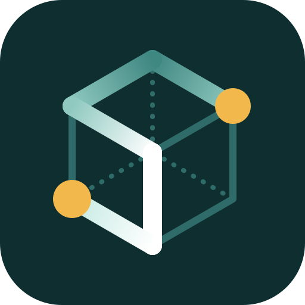

# Stannum

A desktop workbench for power system engineers, built with Tauri 2, Rust and
React. Stannum brings four tools into one app that shares a single open case:

| Module | What it does | Engine |
|---|---|---|
| **Diagram** | Generate one-lines from the open case with power flow results on them, or draw, edit and export your own | React Flow + [ELK](https://eclipse.dev/elk/) |
| **Power flow** | AC/DC power flow, operating-limit checks, result tables and sensitivities | [rs-power](crates/rs-power) |
| **Topology** | Islands, bridges, articulation buses, shortest paths and a network graph | [nodal](crates/nodal) |
| **Case diff** | Exact record-by-record comparison of two RAW cases | Rust port of [case-diff](https://github.com/SklorGalore/case-diff) |

All analysis runs locally in native Rust. Case files never leave your machine.

**Documentation:** the [user guide and technical manual](https://sklorgalore.github.io/StannumRevival/)
cover every module and the solver models behind them. Their source is in
[`docs-site/`](docs-site).


| Power flow | Case diff |
|---|---|
|  |  |


## Using it

Open a case with **Open case…** or drop a `.raw` / `.m` file on the window. The
case bar shows what loaded, and each module uses the case if it can:

- **MATPOWER** (`.m`, version 2) works in Power flow.
- **PSS/E RAW** revisions 23–35 work in Power flow; revision 35 also works in
  Topology; revisions 33 and 35 work in Case diff.

If a module can't use the open case it says why, and the other modules keep
working.

### Log

The strip along the bottom of the window says what Stannum is doing: the step
in progress with a running timer (opening, solving, comparing, drawing), or the
latest message. Click it or press **Ctrl+`** to open the log, which keeps every
step with its time and source: the app's own lines and those from the core,
rs-power and nodal. A power flow is reported as a solver output window would:
the network and controls it starts from, each pass and why it runs, every
Newton iteration with the largest P and Q mismatches and voltage correction
and the buses they are at, each generator switched at a reactive limit, each
switched shunt and tap moved, then totals and operating-limit violations.
Filter to warnings or errors, search, or tick **Details** for parser and
network-assembly lines and the long tails of per-device lists. Bus numbers in a line are links that
show the bus in every module. **Copy** and **Save…** write the lines shown as
plain text, for a bug report or a study record.

### Power flow

Choose AC or DC, the starting voltages, tolerance, Newton iterations and
whether to enforce generator reactive limits, then **Solve**. For RAW cases,
**Switch shunts** and **Adjust transformer taps** (both on by default) let
switched shunts and transformer taps in voltage control hold their buses within
their bands. The overview shows convergence, residual (MVA and p.u.), how many
shunts and taps moved, totals and operating-limit checks
(voltage limits, generator Q limits, branch loading against rate A). The bus,
generator and branch tables are searchable, sortable and export to CSV; rows
outside limits are highlighted. A nonconverged result is kept and labelled so
you can inspect the final iterate.

**Calculate sensitivities** linearizes the solved case. Pick an injection bus
and P or Q, then a response (voltage angle, voltage magnitude or one of the four
branch-end flows), in engineering or raw units, ordered by magnitude, signed
value or input order. "How to read these results" explains the sign conventions.

**Export MATPOWER** writes the input case or the latest solved case.

### Topology

Shows RAW bus, line, transformer, island, bridge and articulation-bus counts, a
Cytoscape network graph and an inspector. Start from a bus's 2-hop
neighborhood, widen it, show a whole island, or show the full network (up to
500 nodes). **Path** finds the fewest equipment hops between two buses.
Tables cover buses, islands, critical connections, equipment and parser
diagnostics; all export to CSV, and **Export JSON** saves the parsed case,
analysis and current path. **Merge zero-impedance branches** treats
zero-impedance lines as a single node.

### Case diff

Choose a baseline and a comparison RAW file (the open case is offered as the
baseline) and **Compare files**. Sections list added, removed, changed and
unchanged counts; select a record to see its fields side by side with the
original lines. Numbers compare exactly (`1.0` equals `1.000`, any other change
counts), string padding is shown in quotes, and formatting, comments and line
endings are ignored. Content in layouts that are not verified is listed as
unsupported and the result is marked incomplete rather than guessed at.

### Diagram

**From case** draws a one-line of the open case (MATPOWER or RAW): the whole
case, one area, or the buses within a few hops of a chosen bus. Buses,
generators, loads, lines and transformers are laid out top to bottom with
right-angle wiring (ELK layered layout, run in a worker). Branches that leave
the selection end in off-page markers naming the far bus. Three-winding
transformers appear as their star point with a two-winding symbol per winding.
Generators, loads and fixed shunts (capacitor or reactor, with Mvar at the
solved voltage) sit directly on their bus bar; the bus's wires leave from the
rest of the bar.

Cases with more than 20 buses default to drawing around a bus, which is how a
one-line is usually used: to look into a local problem. The studied bus sits at
the top, highlighted, and each row below is one more hop out. The bar at the
bottom of the canvas changes the hop count. On a drawing linked to the open
case, double-click an off-page marker to bring its bus in, or right-click a bus
for **Show neighbours** and **Draw N hops around** it. Brought-in buses are
placed below what is already drawn and nothing that is there moves.

Generated symbols stay linked to case records. After a solve (in Power flow, or
**Solve** on the diagram toolbar) the diagram shows bus voltage and angle,
generator and load MW/Mvar, and branch flows with direction arrows and loading;
branches at 80% or more turn amber, overloads red. **Results** toggles them.
A saved diagram keeps the link and shows results again when the same case is open.

The editor also draws by hand: drag symbols from the palette, then drag from a
terminal to wire it. Releasing a wire anywhere along a bus bar adds a tap
there. Symbols sit on a 20 px grid with one stroke weight, so wires line up.
Wires take right-angle paths around symbols and their labels: a new wire is
routed when you draw it, and the wires of a moved symbol are rerouted when you
drop it. Select a wire and drag one of its segments to move it by hand; it then
keeps that shape until you press **Reroute** in its properties.
A generator, load or shunt dropped onto a bus bar, or dragged up until it
touches one, hangs from the bar and is connected there.
Breakers and disconnectors open and close on double-click. A selected bus has a
grip on its far end for changing its length.

**R** turns the selected symbols a quarter clockwise about their centres
(**Shift+R** back, or the buttons under **Rotation** in the properties panel);
terminals turn with the symbol and text stays upright. On a bus, **R** swaps it
between horizontal and vertical: generators, loads and shunts sitting on it go
round with it, and its other wires move to the side of the bar facing where
they go. A symbol dropped beside a vertical bus turns to face it and goes on it.

Any label can be dragged to a clearer spot: a symbol's text, a bus's name and
voltage, or the flow figures on a wire. A label pulled clear of what it belongs
to gets a thin dashed leader back to it, and a wire's figures keep their
distance from the wire when it moves. **Reset label position** in the
properties panel puts one back; turning a symbol does too. Moved labels are
saved with the drawing and appear where they were put in exports.

| Action | How |
| --- | --- |
| Select several | Drag a box on empty canvas, or Shift/Ctrl-click |
| Pan | Middle or right drag, or hold Space |
| Undo / redo | Ctrl+Z / Ctrl+Shift+Z (or Ctrl+Y) |
| Copy, cut, paste, duplicate | Ctrl+C, Ctrl+X, Ctrl+V, Ctrl+D |
| Select all / clear | Ctrl+A / Esc |
| Nudge | Arrow keys (one grid step; Shift for 1 px) |
| Rotate | R (clockwise) / Shift+R; on a bus, horizontal ⇄ vertical |
| Move a label | Drag its text |
| Align and space evenly | Bar over the canvas, shown with two or more symbols selected |

**Print style** draws everything in black for printing and export. Diagrams
save as `.sld` and export to SVG, PNG or PDF with a title block. Keyboard
shortcuts act on the diagram only while it is showing.

Not yet: switched devices and HVDC from the case.

## Development

Prerequisites: Node.js 22+, Rust (stable, edition 2024), and the
[Tauri 2 prerequisites](https://v2.tauri.app/start/prerequisites/) for your
platform (on Linux: `libwebkit2gtk-4.1-dev` and friends).

```sh
npm install
npm run tauri dev      # run the desktop app
npm run tauri build    # package it
```

Checks:

```sh
cargo fmt --all -- --check
cargo clippy --all-targets -- -D warnings
cargo test -p stannum-core -p rs-power -p nodal
npm run build          # type-check and bundle the frontend
npm test               # frontend unit tests (Vitest), e.g. the wire router
```

### Browser smoke test

`tests/browser/smoke.mjs` drives the real UI in Chromium against the real Rust
core. `dev_bridge` serves the same commands as the desktop app over local HTTP,
and the test swaps Tauri's IPC for a shim that calls it:

```sh
cargo run --release -p stannum-core --example dev_bridge &
npm run build && npx vite preview --port 1420 &
F=crates/stannum-core/tests/fixtures
STANNUM_MATPOWER=$F/case9.m STANNUM_RAW=$F/five_bus.raw STANNUM_RAW_B=$F/five_bus_modified.raw \
  node tests/browser/smoke.mjs   # needs Playwright; set STANNUM_SHOTS=dir for screenshots
```

### Checking the case-diff port

`cargo run -p stannum-core --example diff_dump -- a.raw b.raw` prints a full
comparison as JSON in the same shape as a small script over the Python
case-diff, which makes it easy to confirm the two agree on new files.

Branching, pull request rules and the repository's security settings are in
[CONTRIBUTING.md](CONTRIBUTING.md). To report a vulnerability, see
[SECURITY.md](SECURITY.md).

## Layout

```
crates/rs-power/          AC/DC power flow, sensitivities, MATPOWER and RAW loading
crates/nodal/             RAW v35 parser and topology (islands, bridges, paths)
crates/stannum-core/      Analysis core (no Tauri): workspace, power flow, topology, case diff
  src/workspace.rs        The shared open case; parses once per engine
  src/power.rs            rs-power solve/sensitivity results shaped for the UI
  src/diff/               case-diff port: tokenizer, exact values, parser, comparison
  schemas/raw.schema.json RAW field layouts (shared with nodal and case-diff)
  tests/                  Integration tests and fixtures
src-tauri/                Desktop shell; src/analysis.rs exposes the core as commands
src/
  shell/                  Module rail, case bar, drag-and-drop
  modules/                diagram/, power/, topology/, diff/
  lib/analysis/           Typed command wrappers and result types
  ui/                     Shared table and form components
  components/, store/     The diagram editor (from StannumSLD)
tests/browser/            Browser smoke test
```

rs-power and nodal used to be separate repositories. They now live here as
workspace crates, imported with their full git history, and are developed in
this repository only. Each crate has its own README with its API and checks.

## Licensing

rs-power is BSD-3-Clause with MATPOWER attribution (see
`crates/rs-power/NOTICE`). The
`case9.m` test fixture is MATPOWER case data; see
`crates/stannum-core/tests/fixtures/README.md`.

## Logo

The mark is an S traced along the edges of a cube, a tin (Sn) crystal cell drawn as
a network. The masters are `src/assets/stannum-logo.svg` (48 px and up) and
`src/assets/stannum-logo-small.svg` (16 to 32 px). After editing either one, run
`pwsh scripts/update-icons.ps1` to regenerate the Tauri icons, the favicon and the
docs-site logo.
