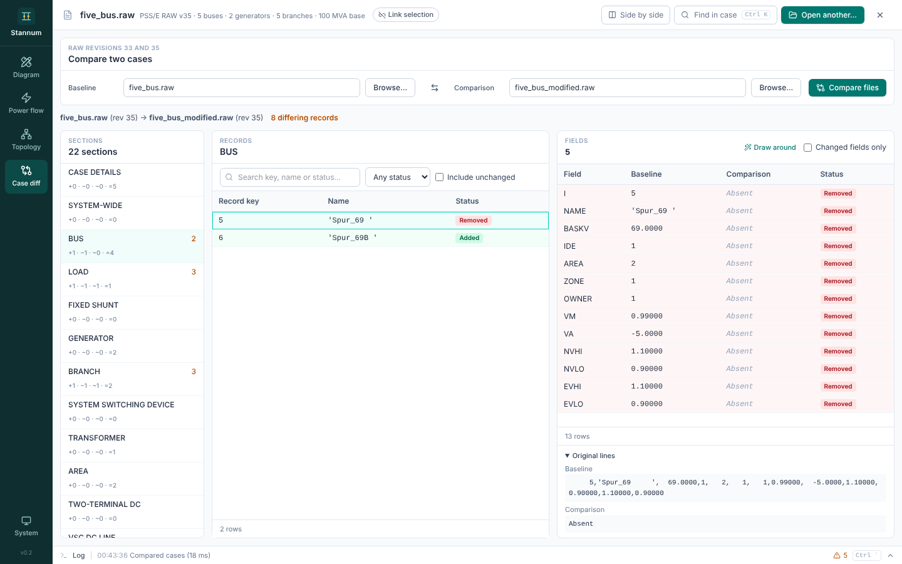
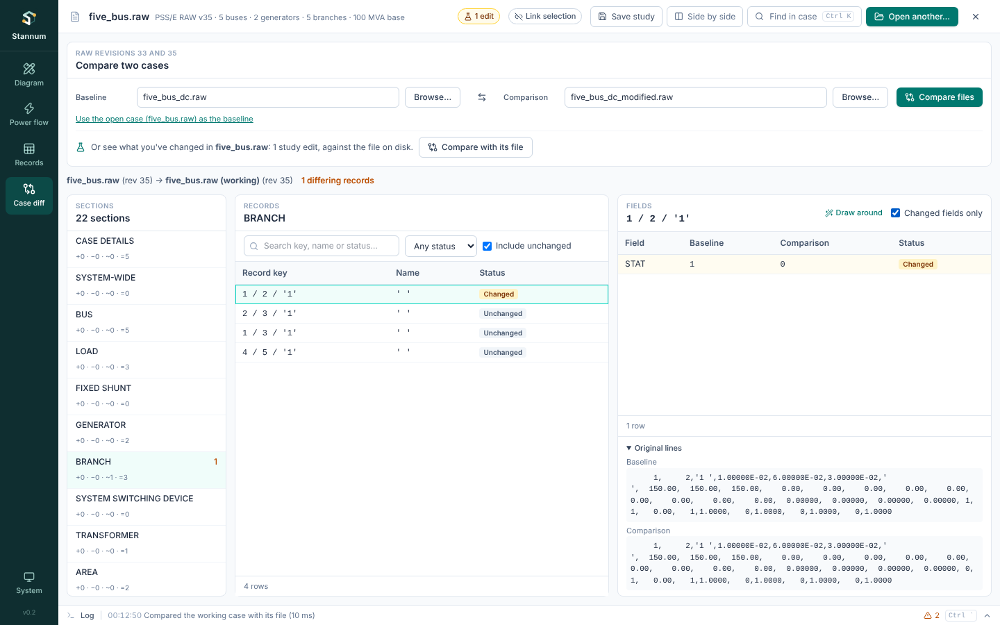

Case diff compares two PSS/E RAW files (revisions 33 and 35) record by record.

## Comparing

1. Choose a **baseline** file. The open case is offered.
2. Choose a **comparison** file.
3. Click **Compare files**.

Each section lists how many records were **added**, **removed**, **changed**
and **unchanged**. Select a section to list its records, and a record to see
its fields side by side with the original lines from both files. Changed
fields are highlighted.

Selecting a record that is a bus, branch, generator or DC line also selects
that element in the other modules, and an element selected elsewhere is found
here.

## What you changed in the open case

**Compare with its file** compares the open RAW case as you are working on it
with the file on disk. The working case is the file with your
[Records](/StannumRevival/guide/records/) edits and your
[study](/StannumRevival/guide/studies/) edits written into the records they
change:

| Study edit | Record fields |
| --- | --- |
| Take out / Put back | `STAT` of the branch, transformer, switching device or generator |
| Set output | The generator's `PG` |
| Set load | The bus's in-service loads: `PL`/`QL`, `IP`/`IQ` and `YP`/`YQ` scaled by the same factors the solve uses (a bus with no load before puts it all on `PL`/`QL` of its first load) |

The Study tab's **Compare with file** button goes straight here. If the study
or the case changes afterwards, a note offers to compare again. Study edits
can be written into RAW revisions 33 and 35; MATPOWER cases aren't compared.

## What counts as a change

- **Numbers compare exactly.** `1.0` equals `1.000`, and any other change in a
  significant digit counts. There is no tolerance.
- **Text compares exactly**, and padding inside quotes is shown in quotes so
  you can see it.
- **Formatting is ignored**: column alignment, comments and line endings.
- Records are matched by their key fields (for example a branch's from bus, to
  bus and circuit), so reordering a section is not a change.

Content in layouts that haven't been verified is listed as **unsupported** and
the result is marked incomplete, rather than guessed at.

See [Case diff](/StannumRevival/manual/case-diff/) in the technical manual for
how records are matched and values compared.
