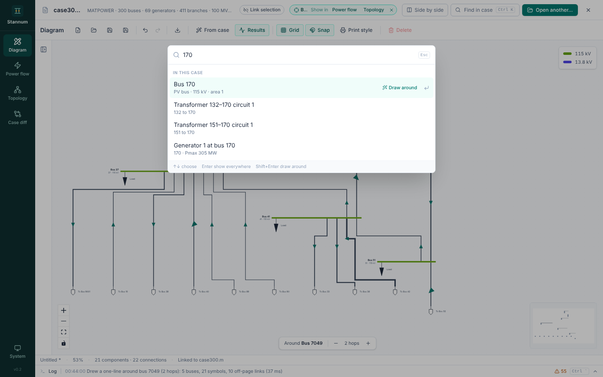
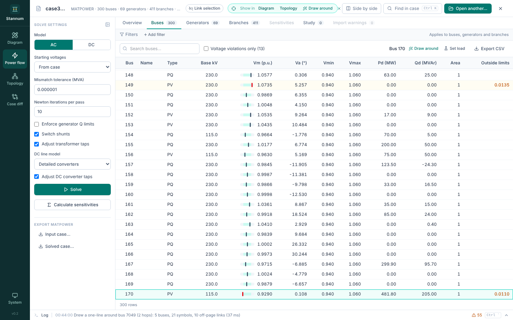

Press <kbd>Ctrl</kbd>+<kbd>K</kbd> (<kbd>Cmd</kbd>+<kbd>K</kbd> on macOS) from
anywhere, or click **Find in case** in the case bar.

## Find an element

Type a bus number, a name or part of one. The palette searches every bus,
branch, transformer, generator and DC line in the open case.

| Key | Does |
| --- | --- |
| <kbd>↑</kbd> / <kbd>↓</kbd> | Move through the results |
| <kbd>Enter</kbd> | Select the element and show it in every module |
| <kbd>Shift</kbd>+<kbd>Enter</kbd> | Draw a one-line around it in Diagram |
| <kbd>Esc</kbd> | Close the palette |

## Run a command

The same box runs commands. Type a few letters of any of these:

- **Open case…** / **Open another case…** and **Close case**
- **Solve power flow**
- **Go to** Diagram, Power flow or Case diff
- **Show topology tables** and **Show layers**, which open them in the Diagram
- **Open … side by side** and **Close side by side**
- **Link selection** / **Unlink selection** and **Clear selection**
- **Switch to dark theme** (or light, or the system theme)
- **Show log** / **Hide log**

Commands match on related words too: "load flow" finds **Solve power flow**,
"split" finds the side by side commands.
