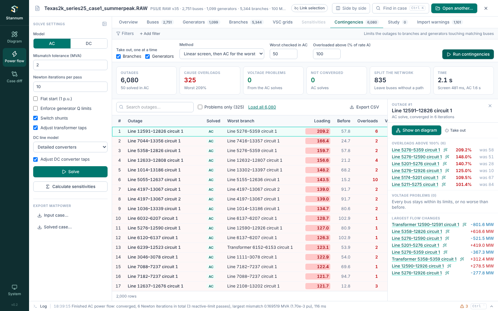
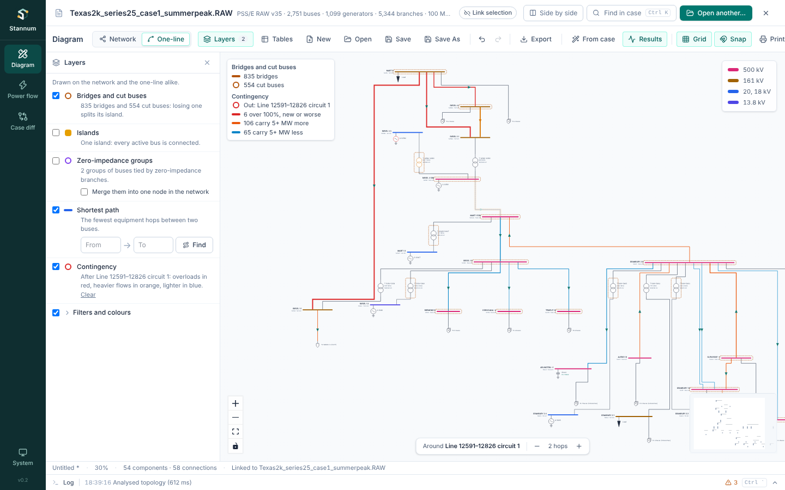
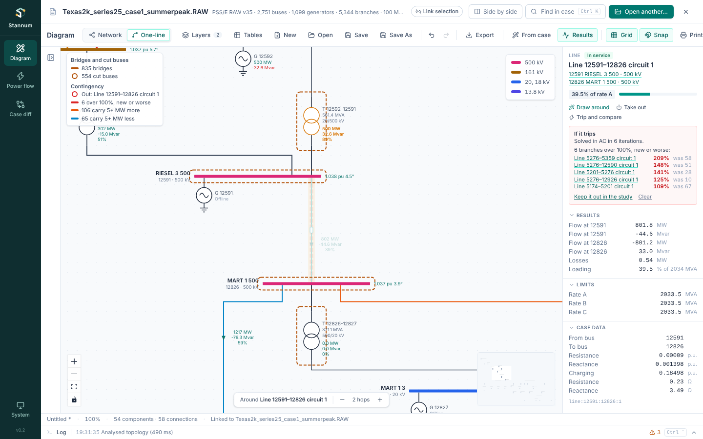

The **Contingencies** tab in Power flow answers "what if it trips?" for every
branch and generator at once. It takes each one out on its own, starting from
the current AC solution (with the study's edits), and ranks the outages by the
overloads and voltage problems they cause.

## Running

Solve the case with the AC model first. Then choose:

- **Take out, one at a time**: branches, generators or both. A
  three-winding transformer goes out as one element. Elements already out of
  service are skipped.
- **Method**: **Linear screen, then AC for the worst** (the default) screens
  every outage with linear outage factors in a fraction of a second, then
  solves the worst N in AC. **AC solve of every outage** is slower on large
  cases but needs no screen.
- **Worst checked in AC**: N, 50 by default.
- **Overloaded above**: the loading, as a percent of rate A, that counts as
  an overload.

The bus filters above the tab narrow the outages to branches and generators
touching the matching buses, for example one area or one voltage level.

**Run contingencies** shows progress while it runs, and **Cancel** stops it;
outages it didn't reach in AC keep their linear result. Texas 2k (6,080
outages) screens in about half a second and solves the worst 50 in AC in
under two seconds.

## Reading the results

The figures at the top count outages that cause overloads, voltage problems
(AC only), AC solves that didn't converge, and outages that split buses off
from the rest of the network.

The table lists one row per outage, worst first: AC results first, then the
linear-only ones. An overload counts when a branch goes over the limit, or
was already over it and gets more than one point worse, so a branch that is
overloaded before any outage doesn't fill the list. **Worst branch** is the
most loaded such branch (or the most loaded branch when nothing is over the
limit) and **Before** its loading without the outage. **Splits off** gives
the buses that lose their path to the rest of the network and the load and
generation on them. **Problems only** hides the rest, and **Export CSV**
saves the list.

Click a row to open the outage beside the table: every overload and voltage
problem, what it splits off, and the largest flow changes. Each element name
selects it, and its wand icon draws a one-line around it. **Take out** adds
the outage to the [study](/StannumRevival/guide/studies/), so the main solve
uses it.

When an AC solve doesn't converge with generator Q limits enforced, the
outage solves again without them, and the note says which: "Converges only
without generator Q limits" points at too little reactive support.

## On the diagram

**Show on diagram** draws a one-line around the outage and turns on the
**Contingency** layer, in either drawing style: the tripped element ringed
in red, overloads in red, branches carrying 5 MW or more extra in orange and
5 MW or more less in blue, buses outside their voltage limits ringed in
amber, and split-off buses faded. Hover a branch for its flow after the
outage. **Clear** in the Layers panel turns it off.

### The result every view shows

While an outage is on the diagram, every view shows that outage's AC
solution instead of the latest solve: the diagram's flow and voltage labels,
the Power flow tables and overview, the **Results** layer and the element
inspector. The case bar says which result is shown (**Outage #3 · Line 6–8
circuit 1 out**, or **Base case**); its menu switches between the latest
solve and the open outage, and the cross goes back to the latest solve. A
new solve, a study change or clearing the outage goes back too.

An outage the run only screened is solved in AC when it is shown. Results
have names, which the log and (later) Python scripts use as well: `base` or
`study` for the latest solve, `contingency 3` for the outage ranked third,
and `trip line:6:8:1` for the last **Trip and compare**.

## Trip and compare

To ask about one element without running every outage, select a branch or
generator anywhere and choose **Trip and compare** in its inspector. It takes
the element out of the latest AC solve, solves again in AC with the same
settings, and draws the result with the **Contingency** layer, around the
element. The inspector's **If it trips** box lists the branches pushed over
the limit (new or worse, as above), voltage problems and any split-off
buses. **Keep it out in the study** turns the trip into a study edit;
**Clear** removes it from the diagram. A contingency run's results are left
as they were.

The method is in [Contingency analysis](/StannumRevival/manual/contingencies/).
