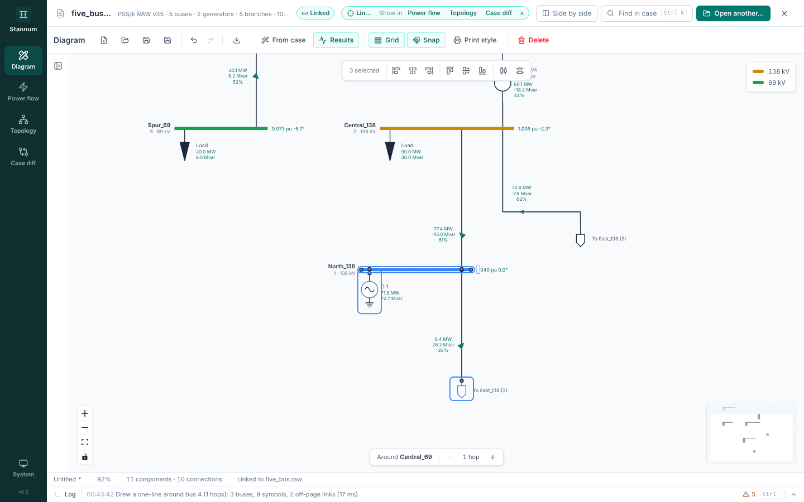
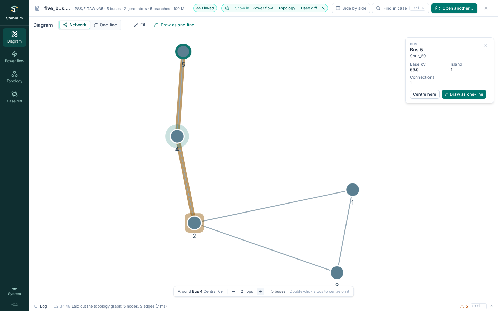
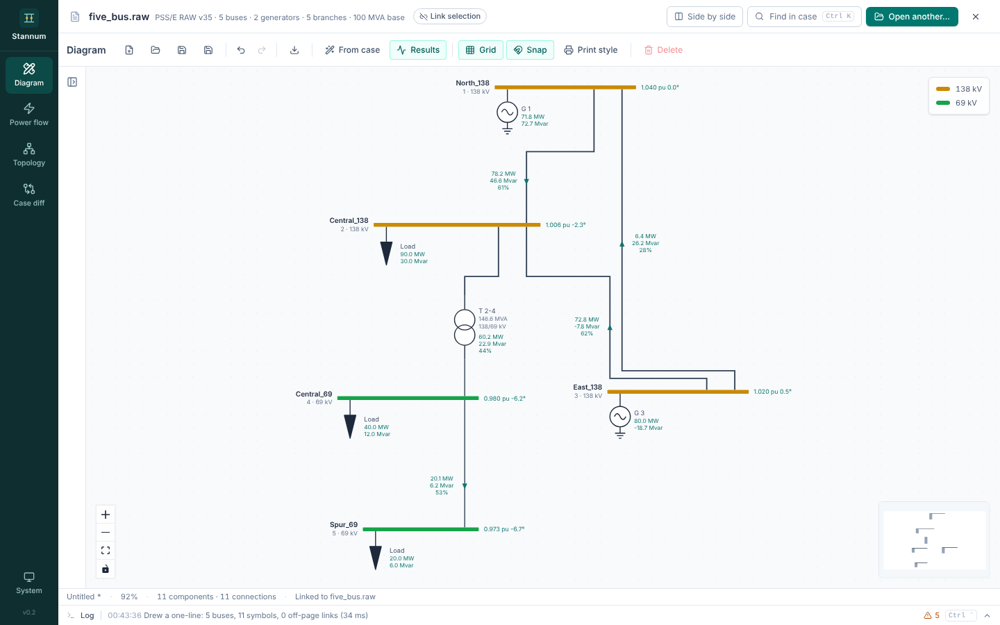
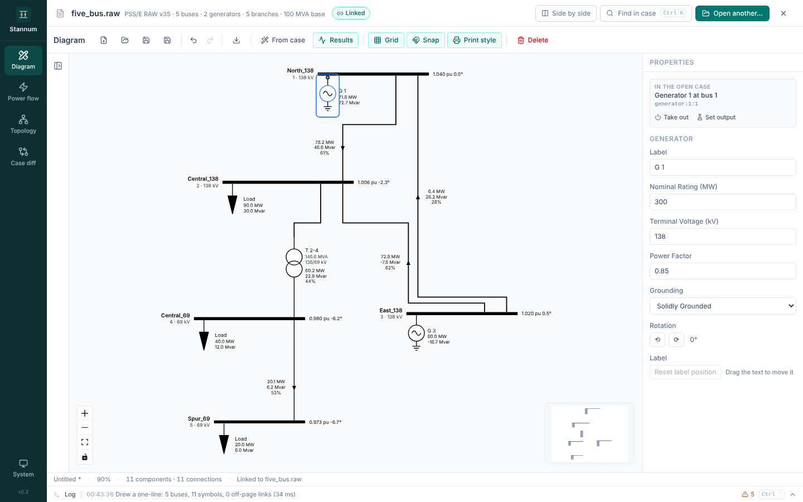

The Diagram module draws single-line diagrams. Most of the time you generate
one from the open case around the element you are looking at; you can also
draw by hand.

## Two drawing styles

The switch at the start of the toolbar draws the same neighbourhood in two
styles:

- **One-line**: symbols, routed wires, results and editing (everything below).
- **Network**: the bus-branch graph from [Topology](/StannumRevival/guide/topology/).
  Buses are dots and branches are lines (transformers dashed), so it stays
  quick and readable for hundreds of buses. Bridges and cut buses are
  highlighted in amber, and the bus it is drawn around has a teal halo.

Switching keeps the bus the drawing is centred on, the hop count and the
selection. Change the hops in the Network style and switch back, and the
one-line is redrawn to match (undoably; a hand-drawn diagram is never
replaced).

In the Network style:

- Click a bus or branch to select it. A card shows its island, connections,
  and whether it is a bridge or a cut bus.
- Double-click a bus, or **Centre here** on its card, to draw around it.
- The bar at the bottom changes the hop count, up to six.
- **Draw as one-line** switches to the one-line drawn around the selection,
  with the same hop count.

"Draw around" from another module and selections from linked modules move
both styles.

## Generating from the case

**From case** draws a one-line of the open case (MATPOWER or RAW): the whole
case, one area, or the buses within a few hops of a chosen bus.

- Buses, generators, loads, lines and transformers are laid out top to bottom
  with right-angle wiring (ELK layered layout, run in the background).
- Branches that leave the selection end in **off-page markers** naming the far
  bus.
- Three-winding transformers appear as their star point with a two-winding
  symbol per winding.
- Generators, loads and fixed shunts (capacitor or reactor, with Mvar at the
  solved voltage) sit directly on their bus bar.
- DC lines are drawn with their converters.

Cases with more than 20 buses default to drawing **around a bus**, which is
how a one-line is usually used. The studied bus sits at the top, highlighted,
and each row below is one more hop out. The bar at the bottom of the canvas
changes the hop count.

The quickest way in is **Draw around** on any selected element, or
<kbd>Shift</kbd>+<kbd>Enter</kbd> in the [palette](/StannumRevival/guide/command-palette/).

### Growing a drawing

On a drawing linked to the open case:

- Double-click an off-page marker to bring its bus in.
- Right-click a bus for **Show neighbours** and **Draw N hops around** it.

Brought-in buses are placed below what is already drawn, and nothing that is
there moves.

## Results on the diagram

Generated symbols stay linked to case records. After a solve (in Power flow,
or **Solve** on the diagram toolbar) the diagram shows:

- bus voltage magnitude and angle,
- generator and load MW and Mvar,
- branch flows with direction arrows, and loading.

Branches at 80% or more of rate A turn amber, overloads red. Wires are
coloured by voltage level, with a legend. **Results** toggles the numbers. At
low zoom the numbers give way to marks that stay readable. A saved diagram
keeps the link and shows results again when the same case is open.

## Drawing by hand

- Drag symbols from the palette, then drag from a terminal to wire it.
  Releasing a wire anywhere along a bus bar adds a tap there.
- Symbols sit on a 20 px grid with one stroke weight, so wires line up.
- Wires take right-angle paths around symbols and their labels. A new wire is
  routed when you draw it, and a moved symbol's wires are rerouted when you
  drop it.
- Select a wire and drag a segment to move it by hand. It keeps that shape
  until you press **Reroute** in its properties.
- A generator, load or shunt dropped onto a bus bar, or dragged up until it
  touches one, hangs from the bar and is connected there.
- Breakers and disconnectors open and close on double-click.
- A selected bus has a grip on its far end for changing its length.

### Rotating

<kbd>R</kbd> turns the selected symbols a quarter clockwise about their
centres (<kbd>Shift</kbd>+<kbd>R</kbd> back, or the **Rotation** buttons in the
properties panel). Terminals turn with the symbol and text stays upright. On a
bus, <kbd>R</kbd> swaps it between horizontal and vertical: devices on it go
round with it, and its other wires move to the side facing where they go.

### Labels

Any label can be dragged to a clearer spot: a symbol's text, a bus's name and
voltage, or the flow figures on a wire. A label pulled clear gets a thin
dashed leader back to its owner. **Reset label position** in the properties
panel puts one back. Moved labels are saved and exported.

## Inspector

Selecting a symbol opens its properties on the right: its case record, solved
values, rotation, label controls and, for case elements, the
[study](/StannumRevival/guide/studies/) actions. The symbol palette on the left
collapses to give the drawing more room.

## Saving and exporting

Diagrams save as `.sld` files (<kbd>Ctrl</kbd>+<kbd>S</kbd>) and export to SVG,
PNG or PDF with a title block. **Print style** draws everything in black.

Not yet generated from the case: switched devices (breakers and disconnectors
exist only in hand drawings).
