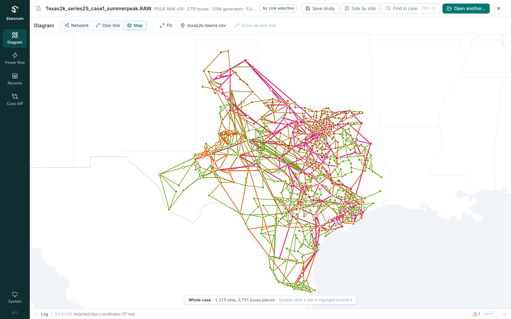
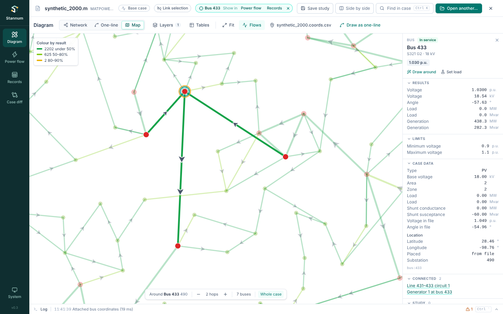
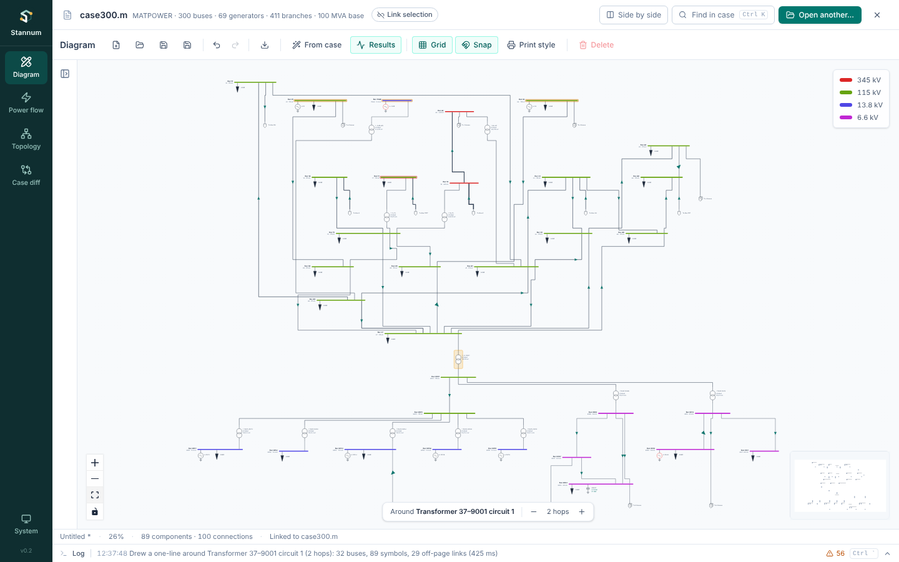
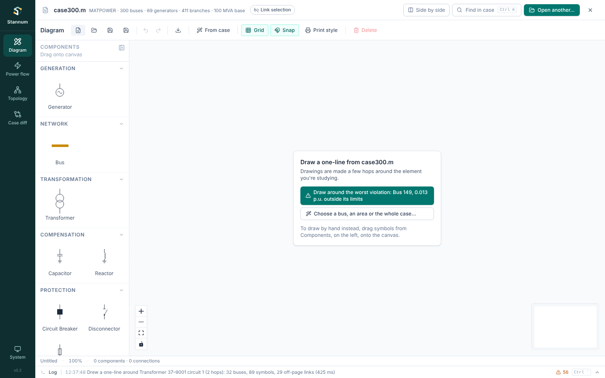

The Diagram module draws single-line diagrams. Most of the time you generate
one from the open case around the element you are looking at; you can also
draw by hand.

## Three drawing styles

The switch at the start of the toolbar draws the same neighbourhood in three
styles:

- **One-line**: symbols, routed wires, results and editing (everything below).
- **Network**: the bus-branch graph of the case's topology. Buses are dots
  and branches are lines (transformers dashed), so it stays quick and readable
  for hundreds of buses. The bus it is drawn around has a teal halo.
- **Map**: the case's buses at their latitude and longitude, over country and
  state outlines (see [The map](#the-map)).

Switching keeps the bus the drawing is centred on, the hop count and the
selection. Change the hops in the Network style and switch back, and the
one-line is redrawn to match (undoably; a hand-drawn diagram is never
replaced).

In the Network style:

- Click a bus or branch to inspect it in the same inspector as the one-line
  (case data, results, limits, study edits). Its **Network** section adds its
  island and connections, and whether it is a bridge or a cut bus.
- Double-click a bus, or **Centre here** in its Network section, to draw
  around it.
- The bar at the bottom changes the hop count, up to six.
- **Draw as one-line** switches to the one-line drawn around the selection,
  with the same hop count.

"Draw around" from another module and selections from linked modules move
both styles.

## The map

The Map style needs a [bus coordinates file](/StannumRevival/reference/coordinates-file/):
attach one from the map's toolbar or the command palette (**Attach bus
coordinates**). The case's buses are gathered into sites, one dot for each
substation the file names (or each point, where it names none), coloured by
the site's highest voltage. Branches are straight lines between sites, and DC
lines are dashed. A site whose buses were all estimated from their lines' lengths,
rather than placed by the file, is drawn hollow.

- The map opens on the whole case. Double-click a site, or **Highlight around
  here** in its Map section, to highlight the buses within a few hops of it;
  everything else is dimmed and the map zooms to fit. The bar at the bottom
  changes the hop count, and **Whole case** clears the highlight.
- Click a site or line to inspect it. A site's Map section lists its buses.
- **Draw as one-line** switches to the one-line around the selected bus.
- The outlines (Natural Earth, public domain) ship with the app, so the map
  works offline. They follow the light and dark themes.

### Layers and results on the map

The map draws the same [layers](#layers-and-tables) as the other styles. A
site stands for several buses, so it takes the colour of the first of its
buses a layer colours (highest voltage first) and fades only when all of them
are filtered out. A transformer inside a substation has no line of its own,
so a layer that marks it (the outage, a bridge) rings its site instead.

- **Flows** in the toolbar (after a solve) draws an arrow on each line
  pointing the way power flows, larger for heavier flows. Hover a line for
  its MW and loading, or a site for its voltages.
- The map shows the same result as every other view: show an outage from
  Contingencies or Trip and compare, and the flows, the colours and the
  outage's status are that outage's. The outage is ringed in red and the map
  highlights around it.
- **Find** in the Shortest path layer highlights the path on the map, with
  everything else dimmed; **Back to around** returns to the neighbourhood.

## Layers and tables

**Layers** draws the case's topology on every style: bridges and cut buses,
islands, zero-impedance groups, a shortest path, and filters and colours by
field. **Tables** opens the topology tables (buses, islands, critical
connections, equipment, diagnostics) in a drawer under the drawing. See
[Topology](/StannumRevival/guide/topology/).

## Generating from the case

**From case** draws a one-line of the open case (MATPOWER or RAW): the whole
case, one area, one zone, one owner (RAW cases), or the buses within a few
hops of a chosen bus.

**Add filter** under the choices narrows any of them by base kV, area, zone
or owner, for example "Base kV ≥ 230" or "Owner is 4". Every filter must
pass. Around a bus, the drawing grows only through buses that pass, so "Base
kV = 345" three hops out draws the 345 kV network near the bus; the studied
bus is always drawn. The dialog counts the buses before you generate.

- Buses, generators, loads, lines and transformers are laid out top to bottom
  with right-angle wiring (ELK layered layout, run in the background).
- Branches that leave the selection end in **off-page markers** naming the far
  bus. When several leave the same bus they share one marker, drawn as two
  flags with a count ("To 3 buses"). Hover it for each branch's far bus and
  flow; it turns amber or red when one of them is heavily loaded.
- Three-winding transformers are one symbol, three overlapping circles, with
  a terminal for each winding. The case's internal star bus is not drawn.
  Each winding's flow is shown on its own wire, and the symbol shows the
  worst winding's loading. With two windings' buses above it, the symbol is
  drawn upside down so both reach a terminal on top. A winding whose bus is
  outside the drawing gets its own off-page marker; double-click it to bring
  that bus in.
- Generators, loads and fixed shunts (capacitor or reactor, with Mvar at the
  solved voltage) sit directly on their bus bar.
- DC lines are drawn with their converters.
- RAW switching devices (revisions 34 and 35) are drawn as breakers (a
  square, filled when closed) and disconnectors (a blade), each with its
  name, whether it is open or closed, and the flow through it. One that isn't
  in its normal position says so in amber, such as "Closed (normally open)".
  Generic connectors (STYPE 1) are drawn as plain wires. Double-click a
  breaker or disconnector to open or close it in the
  [study](/StannumRevival/guide/studies/); the symbol shows the study's state
  at once and the flows follow on the next solve.

Cases with more than 20 buses default to drawing **around a bus**, which is
how a one-line is usually used. The studied bus sits in the middle,
highlighted, with its neighbours shared between the rows above and below it,
each row one more hop out. Long hops fold into several rows, so the drawing
comes out about the shape of the canvas and stays readable when fitted to the
screen (in a half-width split pane it comes out taller). The bar at the bottom
of the canvas changes the hop count.

The quickest way in is **Draw around** on any selected element, or
<kbd>Shift</kbd>+<kbd>Enter</kbd> in the [palette](/StannumRevival/guide/command-palette/).
Drawn around a line or transformer, the drawing grows from both its ends: the
from-side above, the to-side below, and the branch in the middle with a halo.
A generator gets the same halo.

With a case open and nothing drawn, the canvas offers to draw around the
selected element or the worst violation of the last solve (the most
overloaded branch, else the bus furthest outside its voltage limits).

### Growing a drawing

On a drawing linked to the open case:

- Double-click an off-page marker to bring its bus in (all of them for a shared
  marker), or right-click a shared marker to pick one.
- Right-click a bus for **Show neighbours** and **Draw N hops around** it.

Brought-in buses are placed below what is already drawn, and nothing that is
there moves.

## Results on the diagram

Generated symbols stay linked to case records. After a solve (**Solve** in
the top toolbar, in Power flow, or on the diagram toolbar) the diagram shows:

- bus voltage magnitude and angle,
- generator and load MW and Mvar,
- branch flows and loading, with a filled arrow for the way the MW flow goes
  and an open arrow for the way the Mvar flow goes (AC results).

Solving from the top toolbar, the menu bar or Ctrl+K keeps you where you are:
the diagram updates in place. Power flow comes into view only when the solve
fails or does not converge, to show why.

**Canvas > Animated flow arrows** (also under **View** and in Ctrl+K) makes
the MW arrows move along each wire the way the power goes, faster on more
heavily loaded branches. It is off by default and remembered between
sessions. Exports, and systems set to reduce motion, always get still arrows.

Branches at 80% or more of rate A turn amber, overloads red. Wires are
coloured by voltage level, with a legend. **Results** toggles the numbers. At
low zoom the numbers give way to marks that stay readable. A saved diagram
keeps the link and shows results again when the same case is open.

## Drawing by hand

- Drag symbols from the palette, then drag from a terminal to wire it.
  Releasing a wire anywhere along a bus bar adds a tap there.
- Symbols sit on a 20 px grid with one stroke weight, so wires line up.
- Wires take right-angle paths around symbols and their labels. A new wire is
  routed when you draw it, and a moved symbol's wires are rerouted when you
  drop it.
- Select a wire and drag a segment to move it by hand. It keeps that shape
  until you press **Reroute** in its properties.
- A generator, load or shunt dropped onto a bus bar, or dragged up until it
  touches one, hangs from the bar and is connected there.
- Breakers and disconnectors open and close on double-click. (One drawn from
  the case is opened and closed in the study instead.)
- A selected bus has a grip on its far end for changing its length.

### Rotating

<kbd>R</kbd> turns the selected symbols a quarter clockwise about their
centres (<kbd>Shift</kbd>+<kbd>R</kbd> back, or the **Rotation** buttons in the
properties panel). Terminals turn with the symbol and text stays upright. On a
bus, <kbd>R</kbd> swaps it between horizontal and vertical: devices on it go
round with it, and its other wires move to the side facing where they go.

### Labels

Any label can be dragged to a clearer spot: a symbol's text, a bus's name and
voltage, or the flow figures on a wire. A label pulled clear gets a thin
dashed leader back to its owner. **Reset label position**, in the inspector's
**Drawing** section, puts one back. Moved labels are saved and exported.

## Inspector

Selecting a symbol drawn from the case opens the
[element inspector](/StannumRevival/guide/shell/#element-inspector) on the
right, the same one Power flow and Topology show: the element's results,
limits, file data, connections and [study](/StannumRevival/guide/studies/)
edits. The drawing's own fields (rotation, label position, the symbol's
drawing values) are folded into its **Drawing** section. Symbols drawn by hand
show those fields directly. A selected element this drawing doesn't include
is inspected too, with **Draw around** to bring it in. The symbol palette on
the left starts folded while a case is open (drawings come from the case);
open it with the panel button to draw by hand.

## Saving and exporting

The Diagram toolbar's **Drawing** menu holds New, Open, Save, Save as and
Export; its **Canvas** menu holds Grid, Snap and Print style. Diagrams save as `.sld` files
(<kbd>Ctrl</kbd>+<kbd>S</kbd>) and export to SVG, PNG or PDF with a title block.
**Print style** draws everything in black.

