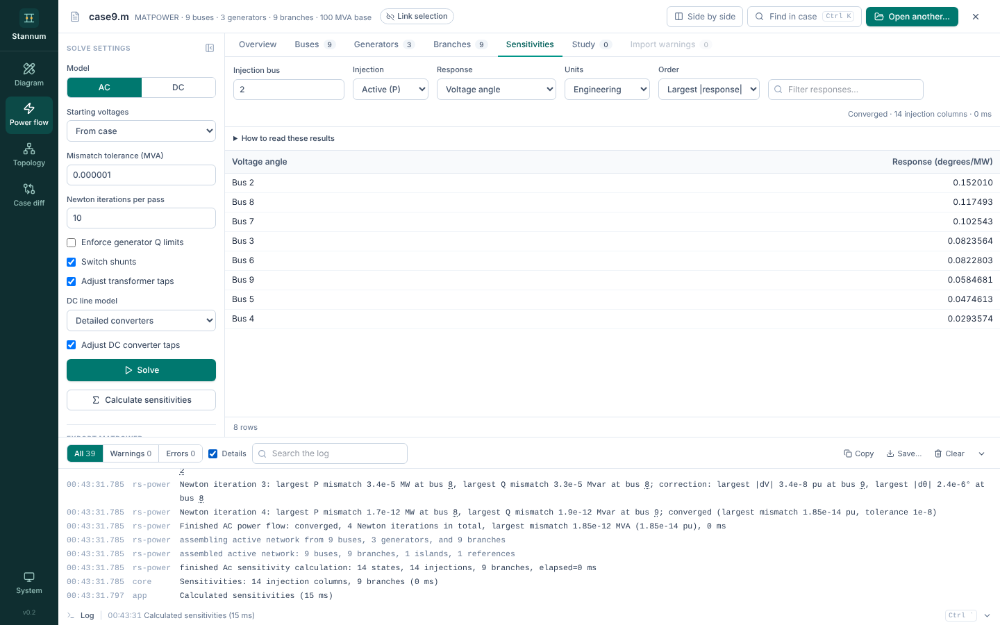

The strip along the bottom of the window says what Stannum is doing: the step
in progress with a running timer (opening, solving, comparing, drawing), or
the latest message. A count appears on it when warnings or errors arrive that
you haven't seen. It counts the open case only: opening another case starts
it again from zero.

Click the strip or press <kbd>Ctrl</kbd>+<kbd>`</kbd> to open the log. Drag
its top edge to resize it.

## What it records

The log keeps every step with its time and source: the app's own lines and
those from the core, rs-power and nodal. A power flow is reported the way a
solver output window would:

1. The network and the controls the solve starts from.
2. Each **pass** and why it runs (first solve, after reactive-limit
   switching, after moving switched shunts and taps, finishing at full
   tolerance, and so on).
3. Every Newton iteration, with the largest P and Q mismatches, the largest
   voltage magnitude and angle corrections, and the buses they are at.
4. Each generator switched at a reactive limit, and each switched shunt and
   tap moved.
5. Totals and operating-limit violations.

The [technical manual](/StannumRevival/manual/ac-power-flow/#passes) explains
what the passes are.

## Filtering and sharing

- Filter to **warnings** or **errors**, or search the text.
- Tick **Details** for parser and network-assembly lines and the long tails of
  per-device lists (the first ten devices moved in a pass are always shown).
- Bus numbers in a line are links: click one to show that bus in every module.
- **Copy** and **Save…** write the lines shown as plain text, for a bug report
  or a study record.

The log keeps the latest 5,000 lines.

## When something goes wrong inside Stannum

A bug in Stannum stops only the step that hit it. A red notice under the case
bar names the step, and the log has the details as an error line. The rest of
the window keeps working: you can try the step again, move on, or save your
study. If one view fails while drawing, that view shows what happened and a
**Draw it again** button, and the other views carry on.

To report the problem, click **Save diagnostics…** on the notice, in the log
toolbar or in the command palette (<kbd>Ctrl</kbd>+<kbd>K</kbd>). It saves a
text file with Stannum's version, the versions of its solvers, your operating
system and the whole log. It does not include the case file or its data, and
paths in your home folder are shortened to `~`. Log lines can still mention
bus numbers and file names, so read the file before you send it if that
matters.
