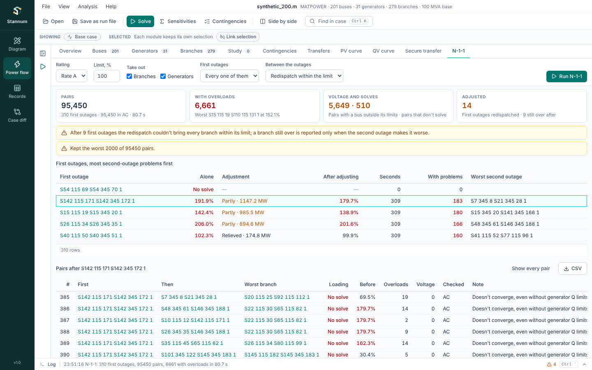

**N-1-1** takes one element out, adjusts the system, then takes out each
other element in turn, as for NERC TPL-001 P6 events: a first outage, the
system adjustments allowed between the two, then the second outage. Open it
from **Analysis → N-1-1** or the command palette (Ctrl+K) after an AC
solve.



## Settings

- **Rating** and **Limit, %**: what counts as an overload after the second
  outage, and the limit the redispatch brings branches within.
- **Take out**: branches, generators or both, first and second.
- **First outages**: every one of them, or only the listed element ids
  (such as `line:205:310:1, generator:3:1`). Each listed element goes out
  first, then every other element.
- **Between the outages**: **Redispatch within the limit** (the default)
  moves generators as little as possible to bring every branch back within
  the limit after the first outage, as
  [Redispatch](/StannumRevival/guide/redispatch/) does; **No adjustment**
  takes the second outage straight after the first.

Each first outage is solved in AC with every control of your last solve.
The second outages then run as an ordinary
[contingency run](/StannumRevival/guide/contingencies/) from the adjusted
case: every outage in AC when there are few of them, otherwise the linear
screen with the worst in AC. A problem is new or worse against the adjusted
case, so a branch the redispatch couldn't bring back is reported again only
when the second outage makes it worse.

## Results

The cards count the pairs, those with an overload, a bus outside its
voltage limits or no AC solution, and how many first outages the redispatch
moved generators after.

**First outages** lists each one: the worst loading it leaves alone, what
the adjustment did and the loading after it, how many second outages found
a problem, and the worst of them. Those that don't solve come first, then
those with the most problems. Click a row to show only its pairs.

**Worst pairs** ranks every pair, AC results first: the worst branch after
both outages and its loading after the first outage and adjustment
(**Before**), the counts of overloads and voltage problems, and why a solve
failed. A big run keeps the worst 2,000 pairs; **CSV** saves them.

## From a run file or Python

```text
run_n11 settings={"first": ["line:1:2:1"], "adjustment": "redispatch", "contingencies": {"limit_pct": 100}}
```

```python
results = case.call("run_n11", settings={"contingencies": {"rating": "b"}, "redispatch": {"rating": "b"}})
```
