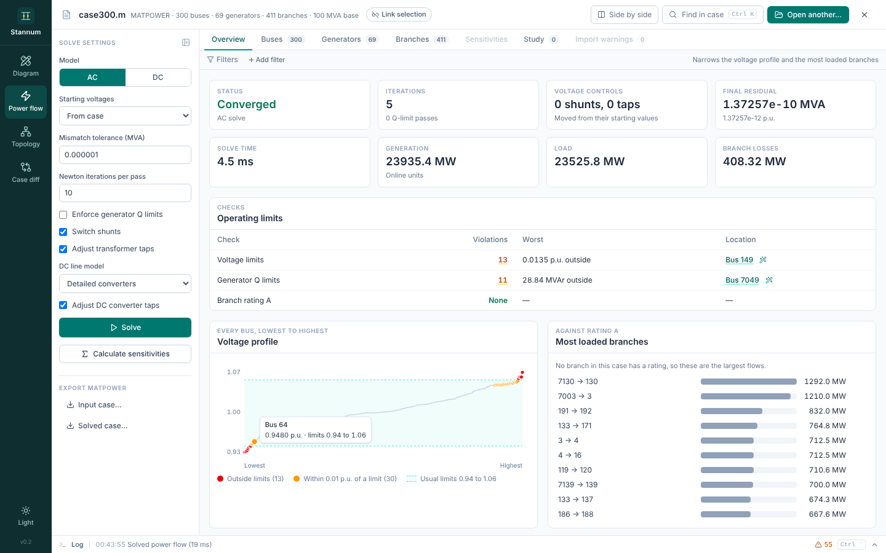
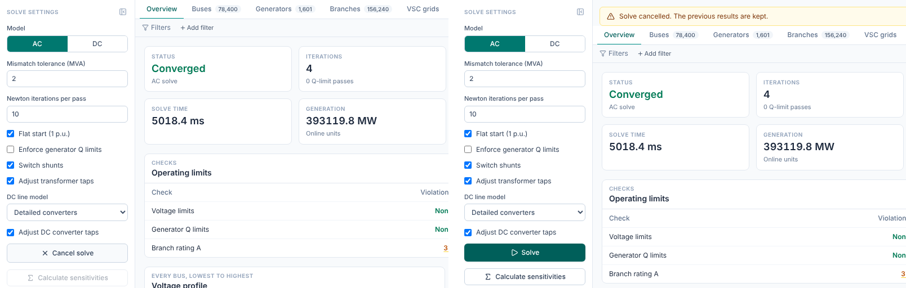
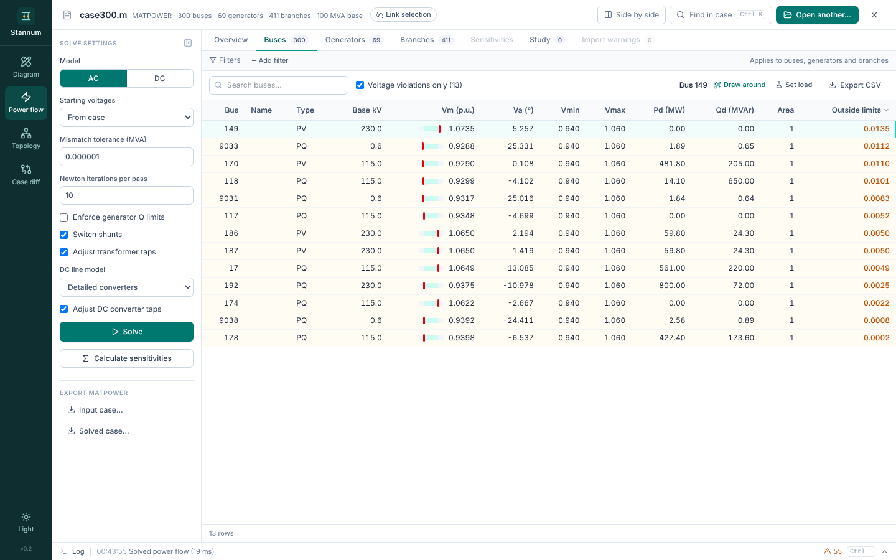
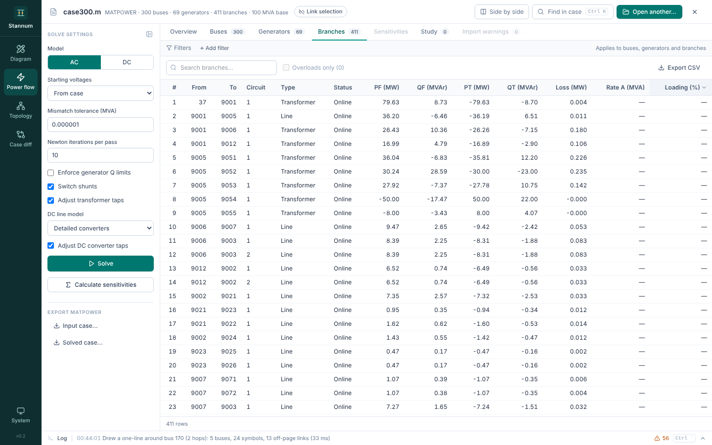
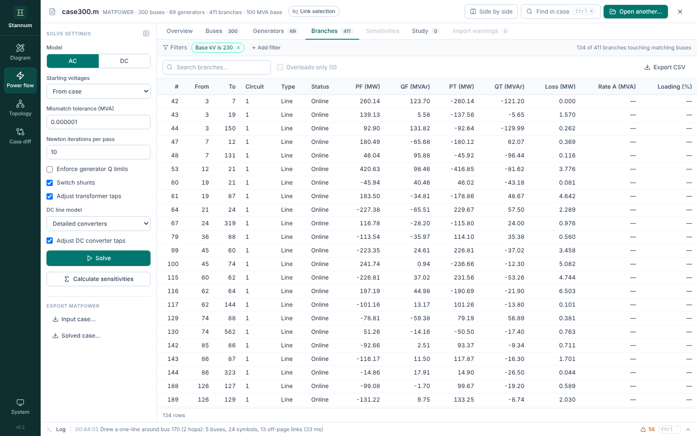
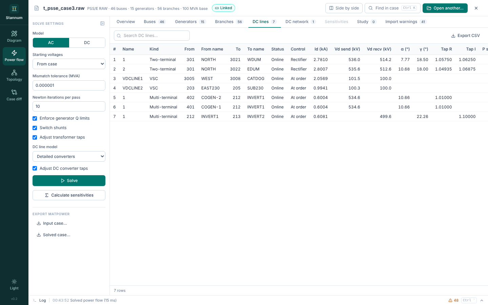
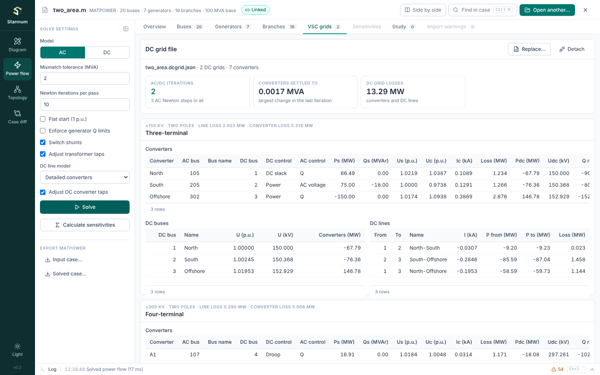
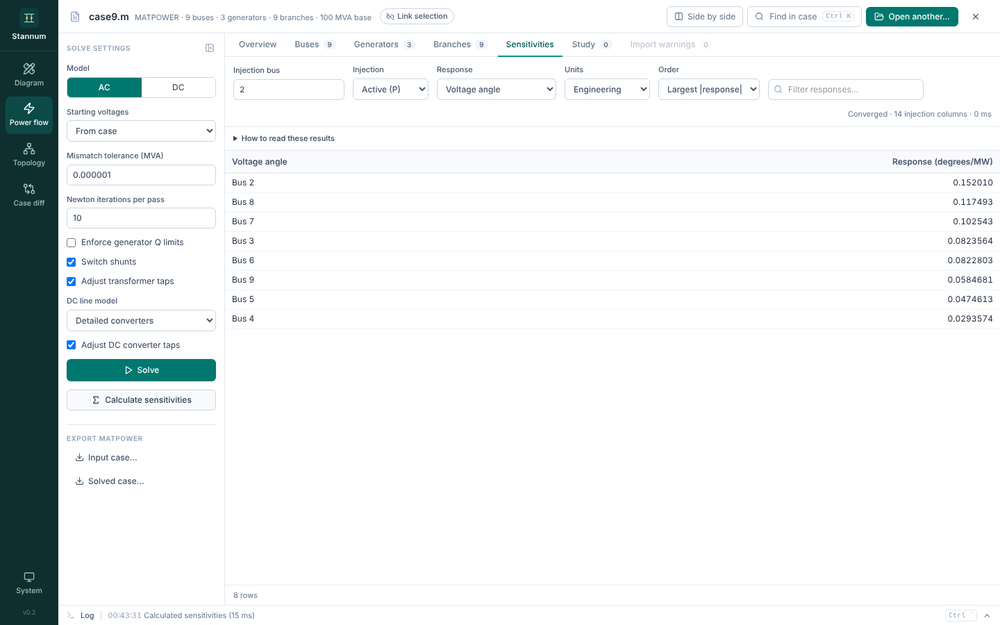

## Solve settings

The settings panel on the left (hide it with the button at its top right)
holds:

| Setting | Meaning | Default |
| --- | --- | --- |
| **Model** | **AC** power flow, or **DC** linear flow | AC |
| **AC method** | **Auto**, **Full Newton**, **Fixed-slope decoupled (FDNS)**, **Fast decoupled (XB)** or **Fast decoupled (BX)**. Every method stops at the same mismatch tolerance; see [AC solution methods](/StannumRevival/manual/ac-methods/) | Auto |
| **Mismatch tolerance (MVA)** | Largest power mismatch allowed at any bus, in MW or Mvar. Hover it to see the value in per unit on the case's base. | 2, on any case's base |
| **Newton iterations per pass** | Newton steps allowed in each pass (Auto and Full Newton) | 10 |
| **Decoupled iterations per pass** | Decoupled iterations allowed in each pass (every method but Full Newton) | 30 |
| **Flat start** | Start from 1 p.u. and reference angles. When it is off, each solve starts where the last one ended, with shunts, taps and generators at Q limits where it left them, and the first solve starts from the voltages saved in the file | Off |
| **Enforce generator Q limits** | Switch generators to fixed Q at their limits, and turn on remote voltage regulation | Off |
| **Move switched shunts** | Let switched shunts in voltage control move (RAW only). Off locks them where they are: where the last solve left them, or at their case values with Flat start | On |
| **Move transformer taps** | Let tap changers in voltage control move (RAW only). Off locks them like shunts | On |
| **DC line model** | **Detailed converters** or the simplified generator pair | Detailed |
| **Adjust DC converter taps** | Let converter taps, and the AC transformers some converters move instead (COD 4), step to hold scheduled DC voltage and firing angles. Off locks them like shunts | On |

**Solve** runs the power flow. You can also solve from the palette or the
diagram toolbar. The [technical manual](/StannumRevival/manual/ac-power-flow/)
explains what each setting does to the solve.

While a solve runs, **Solve** becomes **Cancel solve**, in the settings panel
and on the rail. Cancelling stops the solve before its next Newton step, and
the previous results stay on screen. On a large case this takes about a
second; the log records the solve as cancelled, not failed.

A nonconverged result is kept and labelled, so you can inspect the final
iterate and see where the mismatch is.

## Overview

The overview shows convergence, the residual (MVA and p.u.), iterations
(with the method, and for Auto how many were decoupled and how many Newton), how
many shunts and taps moved, and totals for generation, load and losses. Below
it:

- **Operating limits**: voltage limits, generator reactive limits and branch
  loading against rate A. Each check is a link that opens the matching rows,
  worst first.
- **Voltage profile** and **Most loaded branches** charts.

## Tables

**Buses**, **Generators** and **Branches** list every element with its solved
values. Tables are searchable and sortable, show names, and export to CSV.
Cells carry small bars and colours for voltage against its limits and branch
loading, and rows outside limits are highlighted. The checkbox above each
table (for example **Voltage violations only**) narrows it to the problems.

Selecting a row puts the element in the selection chip and opens its details,
with **Draw around** and the [study](/StannumRevival/guide/studies/) actions.

### Filters

**Filters** above the tables narrows buses, generators and branches together
by field rules, such as base kV = 230 or area = 2. Numbers compare with =, ≠,
>, ≥, <, ≤ or *between*; text with *contains*, *is* or *is not*; any field can
be *missing* or *present*. A branch passes when it touches a bus that passes.

Filters also narrow the overview charts. The operating-limit checks always
count the whole case.

## DC results

When the case has DC lines, two more tabs appear:

- **DC lines**: each two-terminal LCC or VSC line with its control mode, DC
  current and voltages, firing angles and taps, losses, and both ends' P and Q.
- **DC network**: each multi-terminal system with its DC bus voltages, DC link
  currents, flows and losses, and each converter's operating point.

The models behind these numbers are in [HVDC](/StannumRevival/manual/hvdc/overview/).

## VSC grids

**VSC grids** adds meshed and multi-terminal VSC DC grids that aren't in the
case file. **Attach DC grid file…** reads a [Stannum DC grid
file](/StannumRevival/reference/dc-grid-file/), checks it against the case,
and every AC solve after that includes its grids. Before the first solve,
**Attach VSC DC grids…** on the ready-to-solve page leads here.

After a solve the tab shows how many AC/DC iterations the converters took to
settle, the DC grids' losses, and for each grid:

- **Converters**: control modes, the AC injection ($P_s$, $Q_s$), the
  converter's voltage and current, its loss, the DC power and voltage, the
  reactive range its limits allow, and whether a limit reduced its order or
  is still exceeded.
- **DC buses**: voltages in per unit and kV, and what converters inject.
- **DC lines**: current per pole, power at each end and loss.

**Replace…** attaches another file and **Detach** removes the grids; either
solves again when results are showing. The DC (linear) model leaves VSC grids
out. The model is in [Meshed VSC grids](/StannumRevival/manual/hvdc/vsc-grids/).

## Sensitivities

**Calculate sensitivities** linearizes the solved case. Pick an injection bus
and P or Q, then a response: voltage angle, voltage magnitude, or one of the
four branch-end flows. Results are in engineering or raw units, ordered by
magnitude, signed value or input order. **How to read these results**
explains the sign conventions, and the [technical
manual](/StannumRevival/manual/sensitivities/) gives the mathematics.
**Show on diagram** draws a one-line around the injection bus and colours it
by the responses shown, with the Diagram's [Colour by result
layer](/StannumRevival/guide/topology/#colour-by-result).

## Import warnings

For RAW files, **Import warnings** lists everything the conversion
approximated or skipped. Warnings with the same message are grouped, most
frequent first, with how many there are and which lines of the file they come
from. Open a group to list each record with its line number and the branch or
generator it describes; click the element to select it, or use
**Draw around** beside it. The log gets one line per import naming the most
common warning, not a line per record.

## Export MATPOWER

**Input case…** writes the case as loaded (with study edits applied);
**Solved case…** writes the latest solved case. Both are MATPOWER version 2
files that MATPOWER's `loadcase` reads.

## Export PSS/E RAW

**Revision 35…** and **Revision 33…** under **Export PSS/E RAW** (also
**Ctrl+K → Export case as PSS/E RAW 35…/33…**) write the open case as a
complete RAW file, with its Records edits and study edits written in. A bar
under the case bar then says how many records were written and lists
anything the file couldn't keep, such as fields revision 33 has no place
for. See [Writing RAW](/StannumRevival/reference/psse-raw/#writing-raw) for
what each conversion does.
