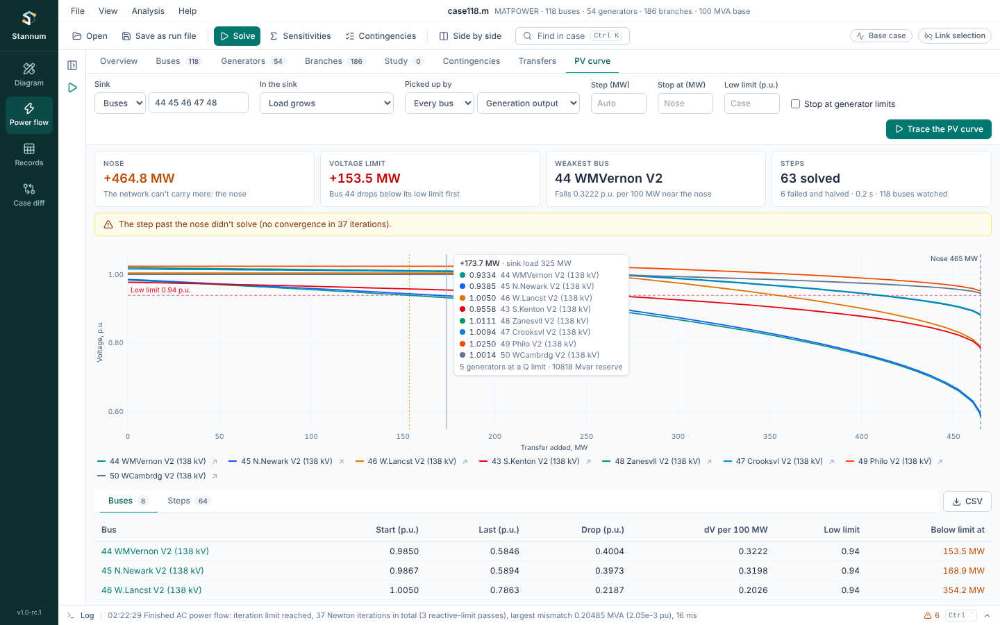

The **PV curve** tab in Power flow answers "how much more load can this
area take before its voltage collapses?". It grows the load in a sink step
by step, re-solving the full AC power flow each time with every control and
reactive limit of your last solve, until the case stops solving: the
**nose** of the curve. On the way it records every bus voltage and draws
the buses that fall furthest. The method is in the
[PV curves](/StannumRevival/manual/pv-curves/) manual page.

## Running

Solve the case with the AC model first. Then choose:

- **Sink**: an area, zone or owner from the list, or **Buses** to type bus
  numbers.
- **In the sink**: **Load grows** (the default) scales every load in the
  sink by the same factor, keeping its power factor. The sink's generation
  can drop instead.
- **Picked up by**: **Every bus** (the default) shares the extra power over
  all online generation; **A source…** picks an area, zone, owner or buses,
  which turns the study into a transfer. The last list says how the source
  shares it: by generator output, by room to Pmax, or by dropping load.
- **Step (MW)**: the first step; blank for 5% of the sink's load. Steps are
  halved near the nose, down to a 32nd of the first.
- **Stop at (MW)**: stop at this transfer; blank to go on to the nose.
- **Low limit (p.u.)**: the voltage that counts as too low; blank for each
  bus's own normal low limit from the case.
- **Stop at generator limits**: stop when the source's generators reach
  Pmax (summed) or a side runs out of load. Untick it to find the nose
  whatever the dispatch.

Then press **Trace the PV curve**. Each step is a full solve, so a 2,000-bus
case takes some seconds; **Cancel** stops it and keeps the curve so far.

## Results

- **Nose**: the extra MW at the last step that solved, and what stopped
  the curve.
- **Voltage limit**: the extra MW at which a bus first drops below its low
  limit, and that bus. This usually comes well before the nose.
- **Weakest bus**: the bus whose voltage falls fastest near the nose.
- **Steps**: steps solved, steps that failed and were halved, and the time.

The chart draws each bus's voltage against the transfer, with the nose,
the low limit and the voltage limit marked. Hover for the values at a step,
including how many generators sit at a reactive limit; click a bus in the
legend to hide it, or its arrow to show the bus.

The tables below:

- **Buses**: each bus with a curve, its voltage at the start and the last
  step, the drop, the drop per 100 MW near the nose, and where it crosses
  its low limit.
- **Steps**: each step's transfer, sink load, losses, lowest voltage,
  generators at a reactive limit, reactive reserve left and iterations.

**CSV** saves every step with each bus's voltage. A new case or a study
change clears the results.

With reactive limits on, a real case often stops where the generators near
the sink run out of reactive power, with voltages still near normal one
step before. On the Texas 2k case, Coast takes about 1.5 GW more load
with reactive limits on, and 26 GW with them off: solve without Q limits
and trace the curve again to see how much the reactive reserve is worth.
