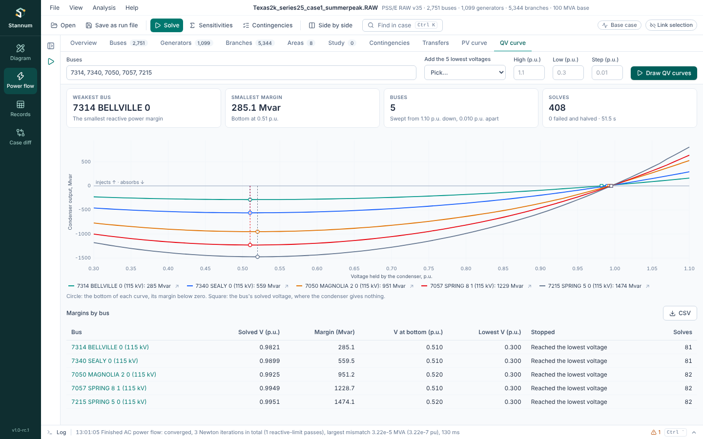

The **QV curve** tab in Power flow answers "how much more reactive load
can this bus take before its voltage collapses?". For each bus you list, a
condenser with no limits holds the bus at one voltage after another, each
a full AC solve with every control and reactive limit of your last solve.
The condenser's output at each voltage is the curve, and how far its bottom
lies below zero is the bus's **reactive power margin**. The method is in
the [QV curves](/StannumRevival/manual/qv-curves/) manual page.

## Running

Solve the case with the AC model first. Then:

- **Buses**: type the bus numbers, separated by commas or spaces. Each bus
  is swept on its own, so a bus takes some seconds on a 2,000-bus case.
- **Add the 5 lowest voltages** adds the five load buses with the lowest
  solved voltage, in the whole case or in one area: usually the first
  buses to check.
- **High**, **Low** and **Step (p.u.)**: the sweep goes from the bus's
  solved voltage up to the high voltage (1.1 p.u. if blank), then down
  towards the low one (0.3 p.u.) in steps (0.01 p.u.). It stops early when
  a lower voltage won't solve.

Then press **Draw QV curves**. The bar shows which bus is being swept, and
**Cancel** stops the study and keeps the curves done so far.

## Results

- **Weakest bus** and **Smallest margin**: the bus closest to voltage
  collapse, and its margin. A margin below zero is shown in red: the bus
  can't hold its voltage without support.
- **Buses** and **Solves**: how many buses were swept, the voltages used,
  solves made and failed, and the time.

The chart draws each bus's curve: the condenser's output (injecting above
zero, absorbing below) against the voltage it holds. A circle marks the
bottom of each curve and a square the bus's solved voltage, where the
condenser gives nothing. Hover for each curve's value at a voltage and
how many generators sit at a reactive limit there; click a bus in the
legend to hide it, or its arrow to show the bus.

The **Margins by bus** table lists each bus's solved voltage, margin,
voltage at the bottom, the lowest voltage that solved and what stopped the
sweep. A margin with ≥ means the curve was still falling at the lowest
voltage, so the true margin is larger; lower the **Low** voltage to find
it. **CSV** saves every point of every curve, under
[metadata rows](/StannumRevival/guide/contingencies/#metadata-rows-in-csv-exports)
with the case and the settings.

The results clear when the case or the study changes.

## Also from

Run files (`run_qv_curve`), Python (`Case.qv_curve`) and the
[MCP server](/StannumRevival/guide/ai-assistants/) (`qv_curve`) run the
same study; see the [manual](/StannumRevival/manual/qv-curves/).
