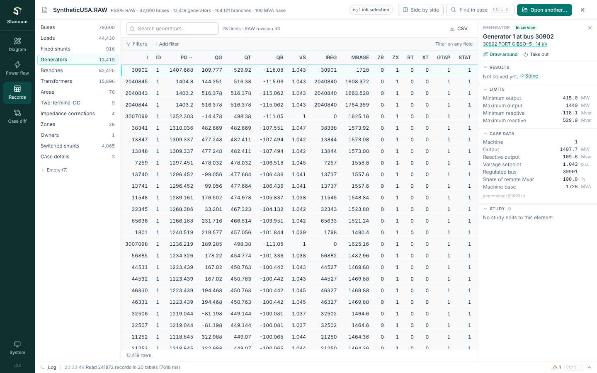

**Records** in the module rail shows the open case as a spreadsheet: one
table per record type, with every field as a column.

## Record types

The list on the left has each record type in the file, with its count:
buses, loads, fixed shunts, generators, branches, switching devices,
transformers, areas, DC lines, FACTS devices, switched shunts and so on, and
the case details (identification, titles and solution settings) last. Types
with no records fold under **Empty**. In a narrow pane the list becomes a menu
above the table.

Where the records come from depends on the file:

- **PSS/E RAW revisions 33 and 35** are read record by record, so the columns
  are the RAW field names (`I`, `NAME`, `BASKV`, `IDE`, …) and the values are
  the file's own. Three-winding transformers, and sections whose layout Case
  diff hasn't verified (fixed shunts in revision 33, for example), are read
  with the layout Stannum knows and say so above the table.
- **MATPOWER files, and other RAW revisions**, show the power flow model's
  tables in MATPOWER's columns (`BUS_I`, `TYPE`, `PD`, …): buses, generators,
  branches, DC lines and generator costs. For a RAW file this sums loads and
  fixed shunts into each bus, and a note says so.

The tables show the case's records. A study's edits aren't applied here;
edit a record (below) to change the case itself.

## Sort, search and filter

- Click a column heading to sort by it; click again to reverse, and a third
  time to return to file order.
- **Search** matches any field.
- **Add filter** works as in Power flow's tables: pick a field, an operator
  and a value. Fields with few distinct values (bus type, area, status, IDs)
  offer their values to pick from; numbers take `=`, `>`, `between` and so on.
  Each record type keeps its own filters.
- **CSV** saves the rows shown, with the RAW line each record starts on.

## Pick a record

Picking a record that is a bus, load, generator, branch, transformer,
switching device or DC line opens it in the element inspector, with its
results, limits, connections and **Draw around**. Shunts and induction
machines open their bus. While selections are linked, a pick here selects the
element in every module, and an element picked elsewhere is found here.

## Edit records

Double-click a cell to change it. Enter or Tab keeps the new value, Esc
leaves the cell as it was, and a number field won't take text. Changed cells
are shaded until you act on them:

- **Apply** writes every change into the case. Power flow, the diagram, the
  inspector and the other modules then use the new values, and the last
  solution is cleared. A study's edits stay and are applied on top.
- **Discard** drops the changes not yet applied.

Fields that identify a record (bus numbers, IDs, the case details) show a lock
and can't be edited, because other records refer to them.

Applied changes live in Stannum until you save them; the file on disk is not
touched. **Save as…** writes the edited case to a new file, and **Revert to
file** opens the file again without them. Closing the case or opening another
asks first while edits are unsaved.

- A **RAW** file keeps its layout: only the edited fields change, padded to
  their old width, and every other line, comment and number is as it was.
- A **MATPOWER** file is written again from the power flow model, so its
  comments and formatting aren't kept.

A change that the power flow can't read (a load on a bus that isn't there, for
example) is refused, and the case stays as it was.
