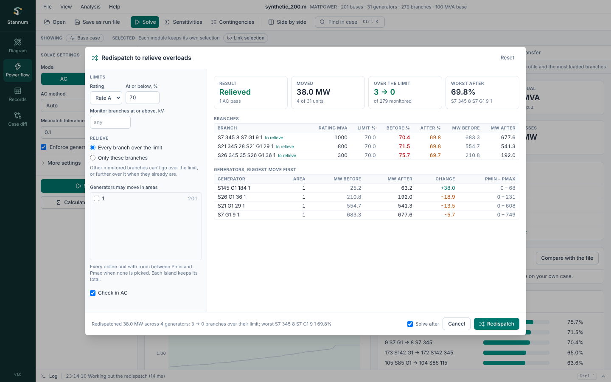

**Redispatch** moves online generators up and down so that branches over
their rating end within it, moving as few megawatts as it can. Open it from
**Analysis → Redispatch to relieve overloads…** or the command palette
(Ctrl+K) after an AC solve. When a branch is selected, the dialog opens set
to relieve that branch.



## Settings

- **Rating** and **At or below, %**: the limit every monitored branch must
  end within, such as rate A at 100%, or rate A at 90% to keep a margin.
- **Monitor branches at or above, kV**: leave blank to monitor every rated
  branch.
- **Relieve**: every branch over the limit, or only the branches listed
  (element ids such as `line:205:310:1`, one per line). Other monitored
  branches may not go over the limit, nor further over it when they
  already are.
- **Generators may move in areas**: every online unit with room between
  Pmin and Pmax when none is picked. Each island keeps its total
  generation, so what goes up in one place comes down in another.
- **Check in AC**: solve the case in AC after each pass and move again
  while a branch is still over. Turn it off for the DC estimate alone.

**Preview** works out the moves without changing anything. It shows the
result, the megawatts moved, how many branches are over the limit before
and after, each branch's loading before and after, and each generator's
move.

**Redispatch** writes the new outputs into the case's generator records, as
[Records](/StannumRevival/guide/records/) edits are, and solves again when
**Solve after** is on. The [history](/StannumRevival/guide/run-files/#history)
keeps it as one `redispatch` line.

## When it can't relieve a branch

The result says **Partly relieved** when a branch stays over:

- the units that move flow off it are at Pmin or Pmax, or not allowed to
  move (widen the areas);
- the branch's own reactive flow is over its rating: moving megawatts
  can't fix that, and the notes say so. Voltage control or switched shunts
  can.

## From a run file or Python

```text
redispatch settings={"rating": "a", "limit_pct": 100, "branches": ["line:1:2:1"]}
```

```python
report = case.call("redispatch_preview", settings={"limit_pct": 95})
case.call("redispatch", settings={"limit_pct": 95, "generators": {"areas": [1, 2]}})
```

See the [technical manual](/StannumRevival/manual/redispatch/) for the
method.
