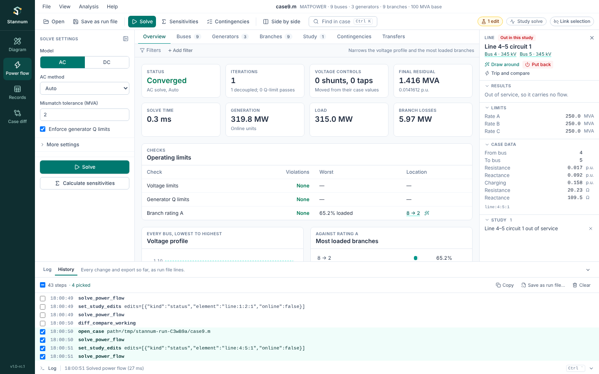
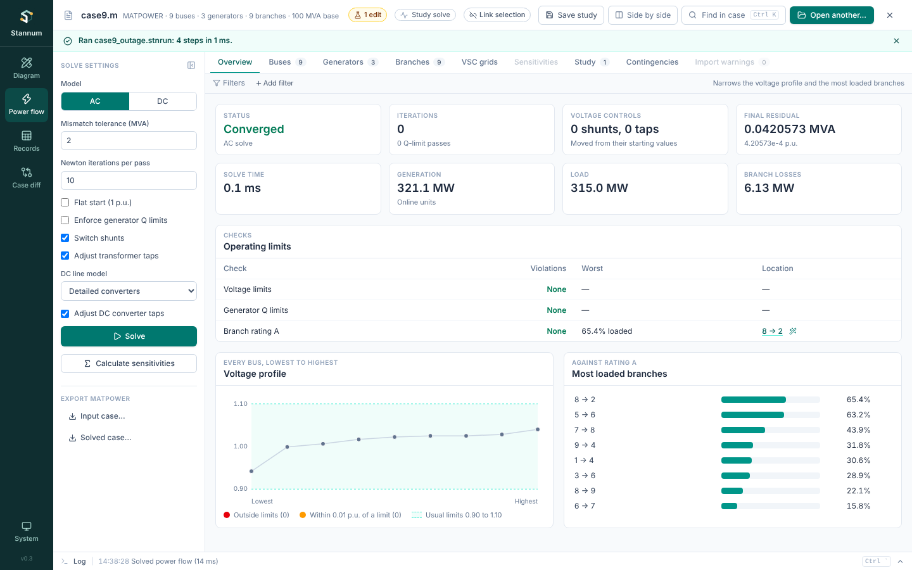

A **run file** (`.stnrun`) is a list of Stannum commands, one per line, that
run in order: open a case, set study edits, solve, run contingencies, export.
Save one from the history of what you did, edit it as text, and play it back
in the app or from a terminal with `stannum-cli`. The format is described in
[Run file format](/StannumRevival/reference/run-file/).

## History

Stannum keeps a **history** of everything that changes the case or writes a
file, in run file form, from the moment it starts. Nothing has to be switched
on. Open it with **File → History…**, **Show history** in the command palette
(Ctrl+K), or the **History** tab of the [log](/StannumRevival/guide/log/)
drawer.

Opening a case, solving, study edits, attaching DC grids or bus coordinates,
contingencies, transfer limits, Trip and compare, Records edits, scaling and
exports are all kept. Looking around (selecting, opening tables, drawing) isn't.
Each line is shown as it would be written in a run file; solve settings at
their defaults are left out.



Click lines to pick them (Shift+click picks a range), or leave none picked to
take them all. Then:

- **Copy** puts them on the clipboard as run file text, ready to paste into
  a file you are writing.
- **Save as run file…** asks where and writes them as a run file. Paths to
  files in the same folder (or below it) are written relative to the run
  file, so the folder can be moved or shared as a whole.
- **Clear** empties the history. Nothing in the case changes.

A part of the history that doesn't start by opening a case begins with the
case that was open at its first line, so it runs on its own. Commands run by
a run file or by an attached Python script aren't listed.

Saved from the history, the steps above look like this:

```text
# stannum-run-file version 1
# Stannum run file, recorded in the app.
# Run it from Ctrl+K > Run a run file, or: stannum-cli run case9_outage.stnrun

open_case path=case9.m
solve_power_flow
set_study_edits edits=[{"element": "line:4:5:1", "kind": "status", "online": false}]
solve_power_flow
```

To keep just where you are now (the case, its side files, the study edits
and a solve), use **Save as run file** in the toolbar; see
[Studies](/StannumRevival/guide/studies/#saving-the-work-as-a-run-file).

## Running in the app

**Open** (or **File → Open case or run file…**), **Ctrl+K → Run a run file…**, or drop a `.stnrun` file on the window. Before
anything runs, every line is checked, so a misspelled command on the last
line stops the file before the first line changes anything. While it runs,
the bar under the toolbar has a **Cancel** button, which stops the run
before its next line (and stops a solve or contingency run in progress).

When it finishes, the app shows the case the run file left open, with its
study edits in the Study tab, and solves it again from the run's solution so
every view has results. The bar says how it went.



A line that fails stops the run, and the bar names the line and why. The
remaining lines don't run.

## Running without the app

`stannum-cli` runs the same files from a terminal or a scheduled job, with no
window:

```text
$ stannum-cli run studies/case9_study.stnrun
   3  ok    open_case                0.00 s
   4  ok    solve_power_flow         0.00 s
   6  ok    set_study_edits          0.00 s
   9  ok    solve_power_flow         0.00 s
  10  ok    run_contingencies        0.01 s
  11  ok    export_matpower          0.00 s
Ran 6 steps in 0.0 s.
```

| Command | What it does |
| --- | --- |
| `stannum-cli run <file>` | Runs every line. Stops at the first failure. |
| `stannum-cli run <file> --keep-going` | Runs the rest after a failure. |
| `stannum-cli run <file> --json` | Also prints the full report, with every command's answer, as JSON on stdout. |
| `stannum-cli run <file> --verbose` | Shows the core's log (solver iterations and so on) as it runs. |
| `stannum-cli check <file>` | Reads the file and lists its steps without running them. |
| `stannum-cli commands` | Lists every command a run file can use, with its arguments. |

It exits with 0 when every line ran, 1 when a line failed or the run was
cancelled, and 2 when the file itself is wrong (a misspelled command or
argument, or a file that can't be read).

Each [release](https://github.com/SklorGalore/StannumRevival/releases/latest)
has it for Windows, Macs with Apple silicon and Linux, as
`stannum-cli-<version>-<platform>.zip` or `.tar.gz` (see
[Download](/StannumRevival/start/download/)). To build it from source:
`cargo build --release -p stannum-cli`; the binary is
`target/release/stannum-cli`.
