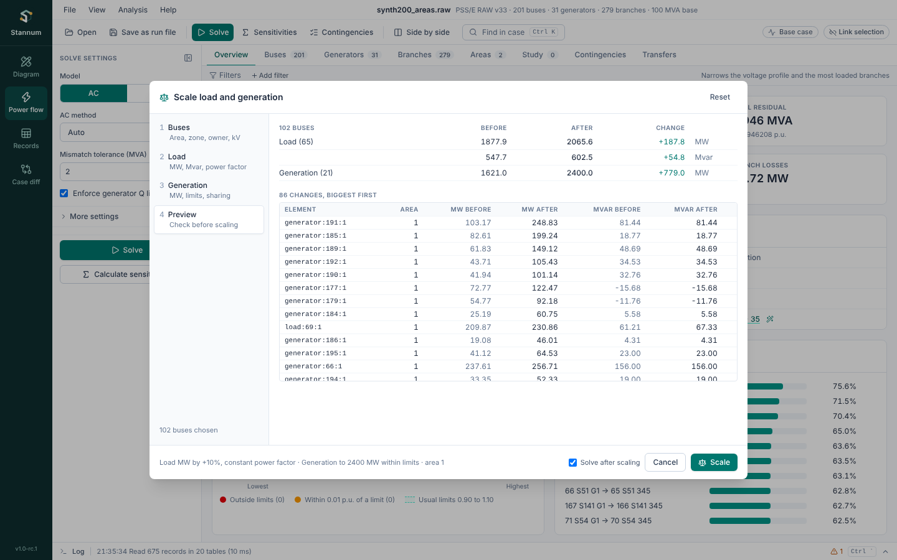

The **scaling wizard** raises or lowers load and generation across part of
the case in one step, as PSS/E's SCAL does. Open it from **Analysis → Scale
load and generation…** or **Scale load and generation…** in the command
palette (Ctrl+K).

The new values are written into the case's records, as
[Records](/StannumRevival/guide/records/) edits are: they're saved with the
case, Case diff shows them, and the [history](/StannumRevival/guide/run-files/#history)
keeps the whole scaling as one `scale_load_generation` line that a run file
or script can repeat.



## 1. Buses

Pick **areas**, **zones** and **owners** from the lists (each shows its bus
count), and an optional **kV range**. A list left empty takes every bus. A
bus must pass every list you pick from, so area 1 with 138 kV and up means
the 138 kV and higher buses of area 1. Buses with no base voltage pass the kV
range. MATPOWER cases have no owners.

## 2. Load

- **Load MW**: a **Target total**, a **Change by** in MW, or a **Change by %**.
  The wizard shows the chosen loads' total now and what it becomes. Leave it
  blank to keep MW as it is and scale only Mvar.
- **Constant power factor** (on by default) moves each load's Mvar by the
  same factor as its MW. Turn it off to scale **Mvar** on its own, with its
  own target or change, or to leave Mvar alone.
- **Parts that scale**: totals are the nominal load at 1 p.u., constant
  power plus constant current plus constant admittance. Scale all three, or
  only the constant power part (PL/QL); the target then counts the parts that
  stay fixed too.
- **Negative loads** are left alone unless **Also scale negative loads** is
  on: they're often small generators modelled as load. Out-of-service loads
  never change.

## 3. Generation

- **Generation MW**: a target total, a change in MW, or a change in percent,
  over the in-service units at the chosen buses. Offline units never change.
- **Respect Pmin and Pmax** stops each unit at its limits; the other units
  pick up what it couldn't take. If they're all full, what is left is shown
  as a shortfall, which the swing bus makes up when the case is solved.
  **Ignore Pmax** lets units go past their limits.
- **Share the change by**:
  - **Present output**: every unit scales by the same factor. Units at 0 MW
    stay there.
  - **Pmax**: bigger units take more, whatever they produce now.
  - **Room to move**: Pmax − PG going up, PG − Pmin going down.

Scaling load alone leaves the swing bus to pick up the change. Scale
generation in the same step to keep the area balanced.

## 4. Preview

The preview follows every change: totals before and after, the biggest
changes element by element, units that end at a limit, and any notes (such
as negative loads left alone). **Scale** writes the change; **Solve after
scaling** (on by default) then solves the case. The log says what changed.

## From a script or run file

The wizard runs the `scale_load_generation` command, and `scale_preview`
answers the same question without changing anything. In a run file:

```text
scale_load_generation settings={"buses": {"areas": [1, 2], "kv_min": 100}, "load": {"mw": {"kind": "percent", "value": 10}, "constant_power_factor": true}, "generation": {"mw": {"kind": "percent", "value": 10}, "respect_limits": true, "participation": "headroom"}}
solve_power_flow
```

From Python:

```python
report = case.call("scale_preview", settings={
    "buses": {"zones": [3]},
    "load": {"mw": {"kind": "target", "value": 450.0}, "constant_power_factor": True},
})
print(report["load"]["mw_before"], "->", report["load"]["mw_after"])
case.call("scale_load_generation", settings={...})
```

Amounts are `{"kind": "target" | "change" | "percent", "value": number}`.
Load takes `mw`, `mvar`, `constant_power_factor`, `parts` (`"all"` or
`"constant_power"`) and `include_negative`; generation takes `mw`,
`respect_limits` (default true) and `participation` (`"output"`, `"pmax"` or
`"headroom"`). The [command reference](/StannumRevival/develop/commands/)
lists every field.
