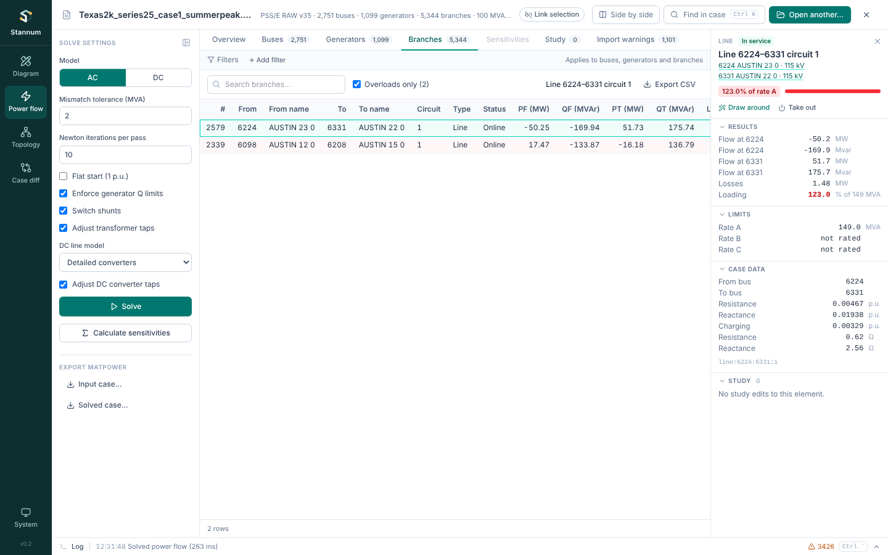

## Module rail

The dark teal rail on the left switches between **Diagram**, **Power flow**,
**Records** and **Case diff**. The case's topology is in the Diagram, as
[layers and tables](/StannumRevival/guide/topology/). Modules stay loaded when you switch away, so a
solved case, a drawn diagram or a comparison is still there when you come
back.

## Menu bar and toolbar

The **menu bar** along the top holds **File**, **View**, **Analysis** and
**Help**, with the open case's name, format and size in the middle. On Windows
it is also the title bar: drag it to move the window.

- **File**: open a case or study (or a recent one, or a sample), save the
  study, save the case as a new file, export the case, attach bus coordinates
  or VSC DC grids, record or run a run file, and close the case.
- **View**: the four modules (<kbd>Ctrl</kbd>+<kbd>1</kbd> to
  <kbd>4</kbd>), side by side, link selection, the Diagram's layers and
  topology tables, import warnings, the log and the theme.
- **Analysis**: solve, sensitivities, contingencies and study edits.
- **Help**: Ctrl+K, keyboard shortcuts, this documentation, updates and
  saving diagnostics.

Click a menu, or press <kbd>Tab</kbd> to it and use the arrow keys.
Every menu entry is also a [Ctrl+K command](/StannumRevival/guide/command-palette/).

The **toolbar** under it holds the everyday actions: **Open**, **Save
study**, **Solve**, **Sensitivities**, **Contingencies**, **Side by side** and
**Find in case** (<kbd>Ctrl</kbd>+<kbd>K</kbd>). On the right it shows the
study badge, which result is shown, and the selection chip. In a narrow window
the buttons drop their labels. See [Open a
case](/StannumRevival/start/open-a-case/#the-menu-bar-and-toolbar).

## Selection

Every bus, branch, transformer, generator and DC line has one identity shared
by all modules. Selecting it anywhere (a table row, a diagram symbol, a
network node, a diff record) puts it in the **selection chip** in the
toolbar. The chip's buttons show the element in another module, and **Draw
around** generates a one-line around its bus. <kbd>Esc</kbd> clears the
selection.

With **Link selection** on, selecting an element also selects it in every
other module, so each module is ready at that element when you switch to it.
[Side by side](/StannumRevival/guide/side-by-side/) turns linking on while it
is open.

## Element inspector

Select an element in Diagram or Power flow and the same inspector
opens on the right:

- **Header**: what the element is, its buses (each a link), whether it is in
  service (or out in this study), the latest solve's headline, such as
  "123.0% of rate A", and the actions: **Draw around**, **Take out** or **Put
  back**, **Set output**, **Set load**.
- **Results**: flows at each end, losses and loading for a branch (one group
  per winding of a three-winding transformer); voltage, angle, load and
  generation for a bus; output against the reactive range for a generator.
  Values outside their limits are red.
- **Limits**: ratings A, B and C, voltage limits, or a generator's MW and Mvar
  range, from the file.
- **Case data**: the file's parameters, such as resistance and reactance in
  per unit and in ohms, transformer ratio and phase shift, or a generator's
  setpoints.
- **Connected**: for a bus, its branches, generators, DC lines and loads.
  Click one to inspect it.
- **Study**: the [study](/StannumRevival/guide/studies/) edits that touch the
  element.

The Diagram's Network style adds a **Network** section (island, connections,
bridges and cut buses, the RAW record), and the one-line adds a folded
**Drawing** section.
Sections fold with a click, and stay as you left them.

## Findings are links

Wherever Stannum reports something about an element, the report leads to it:

- The operating-limit checks on the Power flow overview open the matching
  rows, worst first.
- Bus numbers in [log](/StannumRevival/guide/log/) lines show the bus in every
  module.
- [Studies](/StannumRevival/guide/studies/) and compared solves name elements
  you can draw around.

## Themes

Light, dark and system themes are in the command palette (Ctrl+K, then
"theme": "Switch to dark theme"). Diagrams have a separate **Print style**
that draws everything in black for printing and export.

## Log strip

The strip along the bottom says what Stannum is doing. Click it, or press
<kbd>Ctrl</kbd>+<kbd>`</kbd>, to open the [log](/StannumRevival/guide/log/).
