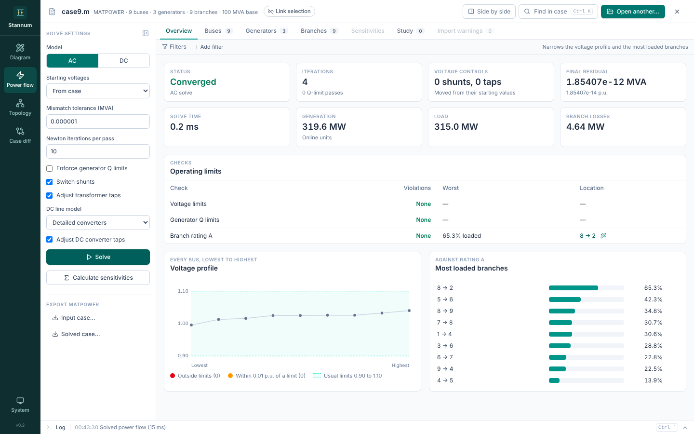
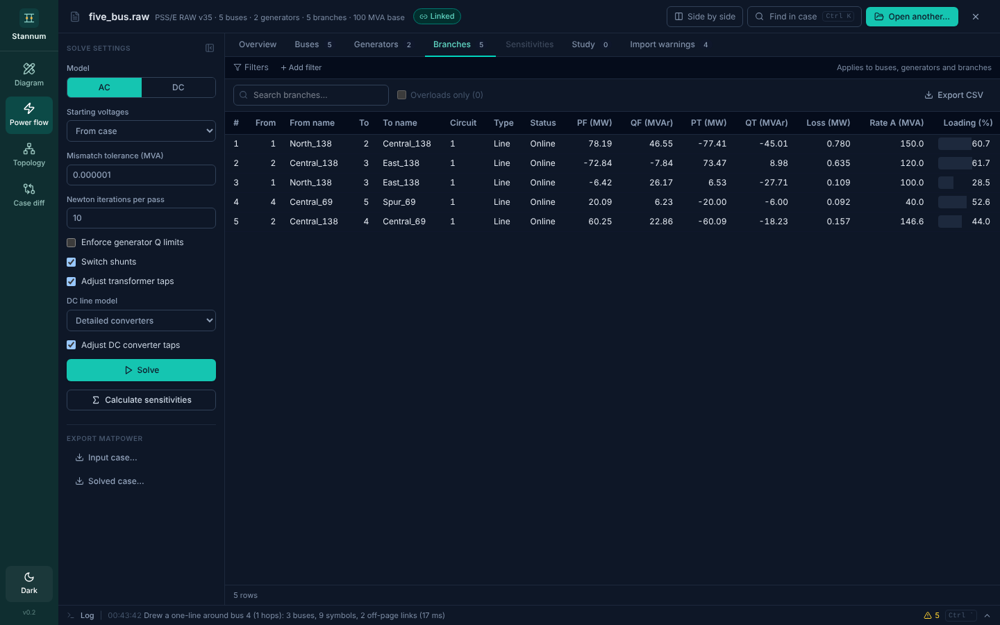

## Module rail

The dark teal rail on the left switches between **Diagram**, **Power flow**,
**Topology** and **Case diff**. Modules stay loaded when you switch away, so a
solved case, a drawn diagram or a comparison is still there when you come
back. The theme button at the bottom of the rail (it reads **System**,
**Light** or **Dark**) cycles through the three themes.

## Case bar

The bar along the top shows the open case and holds the controls that apply to
every module: link selection, the selection chip, side by side, find
(<kbd>Ctrl</kbd>+<kbd>K</kbd>) and open. See [Open a
case](/StannumRevival/start/open-a-case/#the-case-bar).

## Selection

Every bus, branch, transformer, generator and DC line has one identity shared
by all modules. Selecting it anywhere (a table row, a diagram symbol, a
topology node, a diff record) puts it in the **selection chip** in the case
bar. The chip's buttons show the element in another module, and **Draw
around** generates a one-line around its bus. <kbd>Esc</kbd> clears the
selection.

With **Link selection** on, selecting an element also selects it in every
other module, so each module is ready at that element when you switch to it.
[Side by side](/StannumRevival/guide/side-by-side/) turns linking on while it
is open.

## Findings are links

Wherever Stannum reports something about an element, the report leads to it:

- The operating-limit checks on the Power flow overview open the matching
  rows, worst first.
- Bus numbers in [log](/StannumRevival/guide/log/) lines show the bus in every
  module.
- [Studies](/StannumRevival/guide/studies/) and compared solves name elements
  you can draw around.

## Themes

Light, dark and system themes are available from the theme button on the
rail or the palette ("Switch to dark theme"). Diagrams have a separate **Print style**
that draws everything in black for printing and export.

## Log strip

The strip along the bottom says what Stannum is doing. Click it, or press
<kbd>Ctrl</kbd>+<kbd>`</kbd>, to open the [log](/StannumRevival/guide/log/).
