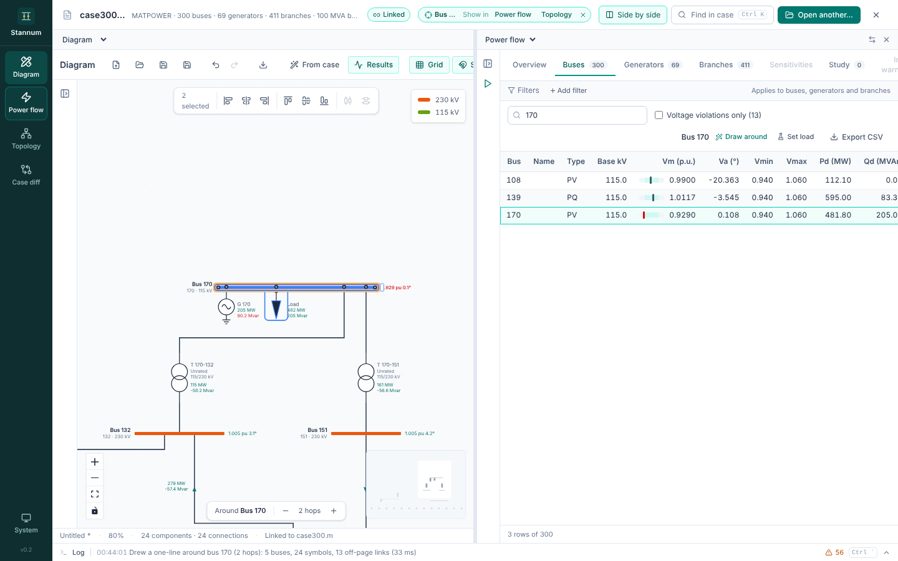

**Side by side** in the case bar shows two modules at once. The usual pairs
are a generated one-line beside the Power flow tables, or Topology beside the
diagram.

- When it opens without a choice, the right pane shows Power flow beside
  Diagram, and Diagram beside anything else. The palette's **Open … side by
  side** commands choose the module.
- Each pane has a header to change its module. The right pane's header also
  has **Swap sides** and **Close**.
- Drag the divider to resize the panes, or focus it and use <kbd>←</kbd> and
  <kbd>→</kbd>.
- Opening side by side turns **Link selection** on, so selecting in one pane
  selects in the other. If it was off before, closing side by side turns it
  off again.
- The module rail still switches the left pane.

## Narrow panes

Each module lays itself out for the width of its pane, not the window:

- Tabs that don't fit move into a **More** menu at the end of the tab row.
  The open tab always stays in the row.
- The Diagram toolbar drops its labels first, then moves the file buttons
  (New, Open, Save, Save as, Export) and the view toggles (Grid, Snap, Print
  style) into a **⋯** menu.
- The Diagram's inspector floats over the right of the drawing instead of
  taking a column, and the hop bar moves beside the zoom controls so the
  inspector doesn't cover it.
- Power flow folds its solve settings into a narrow rail. Its own inspector
  steps aside while the other pane already shows the selection.
- In the case bar, the selection's **Show in** links fold into a menu when
  the window is too narrow for them.

The [log](/StannumRevival/guide/log/) sits under both panes.
