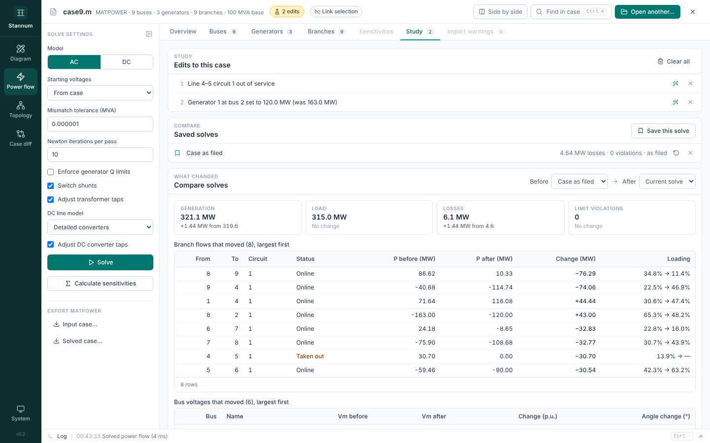
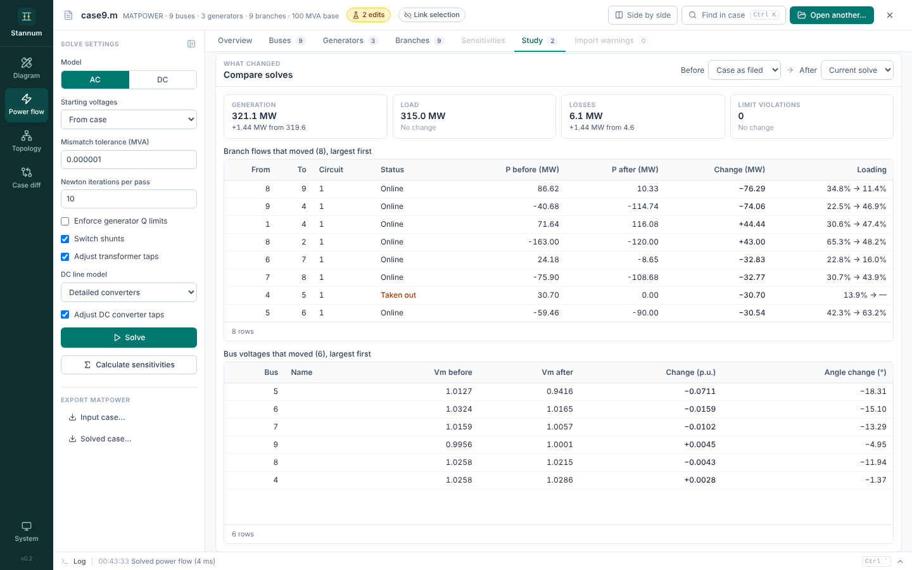

A **study** is a list of edits to the open case that every solve uses, without
changing the file. Use one to take a line out, move generation or change a
load, and see what it does.

## Making edits

Edits are made where the element is shown: in the
[element inspector](/StannumRevival/guide/shell/#element-inspector) in any
module, or in a Power flow table's selection bar when the pane is too narrow
for the inspector. The inspector's **Study** section lists the edits that
touch the element, each with a button to remove it.

| Edit | Applies to |
| --- | --- |
| **Take out** / **Put back** | Lines, transformers (every winding of a three-winding transformer goes together) and generators |
| **Set output** | A generator's active power in MW |
| **Set load** | A bus's total load in MW and Mvar |

**Set output** and **Set load** open a small form; **Apply to study** adds the edit.

The case bar shows a badge ("2 edits") while a study is changing the case, and
the edits take effect on the next solve. Every edit names an element that
exists; an edit that names nothing in the case is refused rather than ignored.

## The Study tab

Power flow's **Study** tab lists the edits in order, each with what it was
before ("was 163.0 MW"). Remove one with its **×**, draw around its element,
or **Clear all**.

## Saving and comparing solves

**Save this solve** keeps the current result under a name you can edit. Each
saved solve shows its losses, violation count and how many edits it used, and
**Restore** goes back to its edits.

**Compare solves** puts any two saved solves (or the current one) side by
side: generation, load, losses and limit violations, then the branch flows and
bus voltages that moved, largest first.

## Scope

Studies change what Power flow and the diagram's results show. Topology and
Case diff always show the file as it is.
