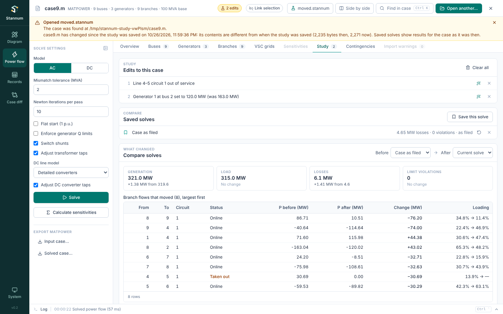
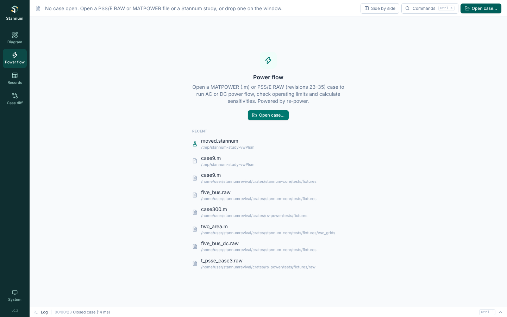

A **study** is a list of edits to the open case that every solve uses, without
changing the file. Use one to take a line out, move generation or change a
load, and see what it does.

## Making edits

Edits are made where the element is shown: in the
[element inspector](/StannumRevival/guide/shell/#element-inspector) in any
module, or in a Power flow table's selection bar when the pane is too narrow
for the inspector. The inspector's **Study** section lists the edits that
touch the element, each with a button to remove it.

| Edit | Applies to |
| --- | --- |
| **Take out** / **Put back** | Lines, transformers (every winding of a three-winding transformer goes together) and generators |
| **Set output** | A generator's active power in MW |
| **Set load** | A bus's total load in MW and Mvar |

**Set output** and **Set load** open a small form; **Apply to study** adds the edit.

The case bar shows a badge ("2 edits") while a study is changing the case, and
the edits take effect on the next solve. Every edit names an element that
exists; an edit that names nothing in the case is refused rather than ignored.

## The Study tab

Power flow's **Study** tab lists the edits in order, each with what it was
before ("was 163.0 MW"). Remove one with its **×**, draw around its element,
or **Clear all**.

## Saving and comparing solves

**Save this solve** keeps the current result under a name you can edit. Each
saved solve shows its losses, violation count and how many edits it used, and
**Restore** goes back to its edits.

**Compare solves** puts any two saved solves (or the current one) side by
side: generation, load, losses and limit violations, then the branch flows and
bus voltages that moved, largest first.

## Saving a study to a file

**Save study** in the case bar writes the work to a `.stannum` file so it
survives closing Stannum and can be handed to someone else. It keeps:

- the study edits and saved solves (with the compare choice),
- the solve settings and the contingency settings,
- the one-line drawing, if there is one,
- which modules are showing, side by side or not,
- the attached DC grid file, by path,
- the attached bus coordinates file, by path.

The case itself isn't copied in. The study refers to the case file by its
path, by its path relative to the study, and by a fingerprint (its SHA-256),
so keep the study beside the case or in a folder near it. Once a study is
saved, the button shows its name, with a dot while there are changes since the
last save; click it to save again. **Save study as…** in the command palette
(Ctrl+K) writes a copy.

If the case has values edited in [Records](/StannumRevival/guide/records/)
that aren't in a file yet, Stannum asks you to save the edited case first, and
the study then refers to that file.

## Opening a study

**Open case…** (or **Open another…**) also opens `.stannum` files, as does
**Open study…** in the command palette and dropping one on the window. The
case opens, the edits are applied, saved solves come back and the case is
solved again with the saved settings.

Stannum says so under the case bar when:

- **the case moved.** It looks for the case where it was, then at the same
  place relative to the study, then beside the study. If none of those has it,
  it asks you to find it.
- **the case changed.** If the file's contents differ from when the study was
  saved, the study still opens, and the saved solves keep showing the results
  of the case as it was then.
- **an edit no longer fits.** An edit naming an element that is no longer in
  the case is left out, and the message lists it.

Before a different case or study replaces one with unsaved changes, Stannum
asks whether to discard them.

## Recent files

With no case open, Power flow and Records list the cases and studies opened
most recently. Click one to open it, or hover and press **×** to drop it from
the list. The list is kept on this computer only.

## Scope

Studies change what Power flow and the diagram's results show. The topology
layers and tables, and Case diff, always show the file as it is.
