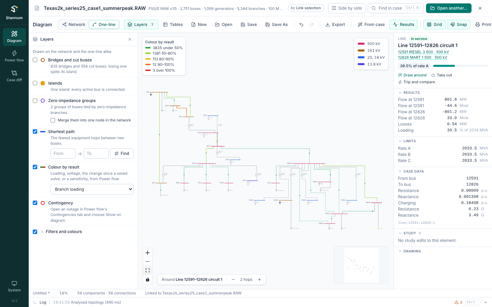
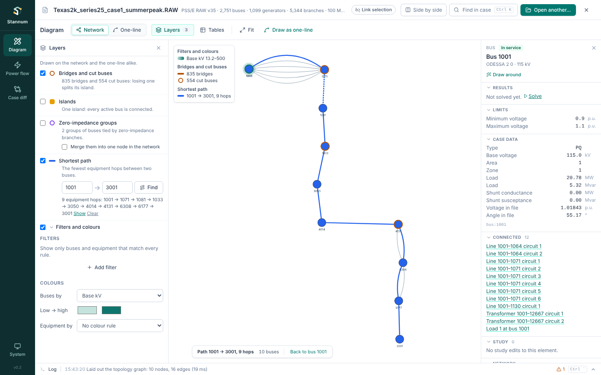
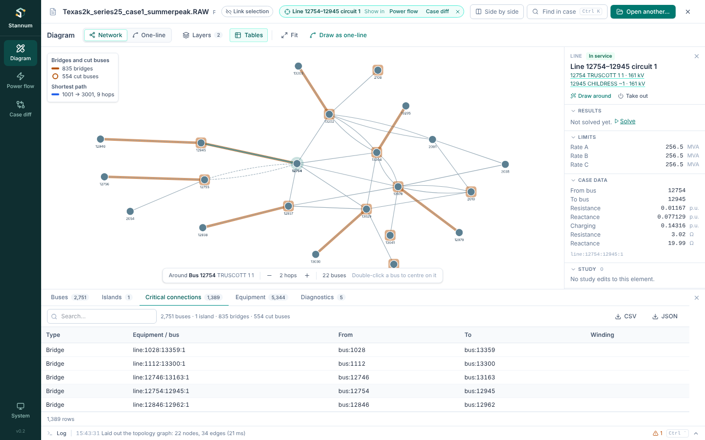
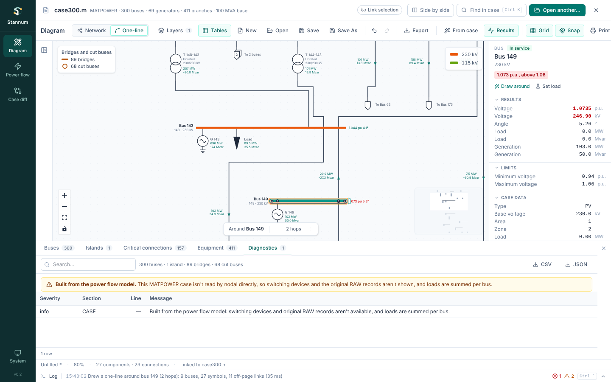

The network's topology (which buses are joined, and by what) lives in the
[Diagram](/StannumRevival/guide/diagram/). Its findings are drawn as
**layers** on either drawing style, and its tables sit in a **Tables** drawer
under the drawing. There is no separate Topology module any more: what used to
be there is now in these two places.

## Layers

**Layers** in the Diagram toolbar opens the Layers panel beside the drawing.
Each layer has a switch, and every layer that is on is drawn on the Network
style and the One-line style alike, with a key in the top-left corner of the
drawing.

| Layer | Draws |
| --- | --- |
| **Bridges and cut buses** | A dashed amber ring around each bridge (a branch whose loss splits its island) and each cut bus (a bus whose loss splits one). On by default. |
| **Islands** | Each island's buses in its own colour, largest island first. |
| **Zero-impedance groups** | A purple ring around buses tied by zero-impedance branches. **Merge them into one node in the network** treats each group as one node, as PSS/E does. |
| **Shortest path** | The fewest equipment hops between two buses, in blue and drawn heavier. |
| **Filters and colours** | Field rules: filters, and colours by a field. |
| **Colour by result** | The latest solve's branch loading or bus voltage, the change since a saved solve, or a sensitivity. See below. |
| **Contingency** | An outage from Power flow's Contingencies tab or **Trip and compare**. See [Contingencies](/StannumRevival/guide/contingencies/#on-the-diagram). |

### Shortest path

Type two bus numbers and **Find**. Each piece of equipment crossed counts as
one hop, so a three-winding transformer is one hop between any two of its
windings. The Network style then shows just the path and its neighbours;
**Back to bus …** returns to the neighbourhood. On the one-line, the path's
buses and branches that are in the drawing turn blue.

### Colour by result

Choose what to colour by:

- **Branch loading**: each branch by its loading in % of rate A, in five bands
  from green (under 50%) to red (over 100%, drawn heavier). Branches without
  a rating stay uncoloured.
- **Bus voltage**: each bus by its voltage, from dark blue (under 0.95 p.u.)
  through grey (0.98 to 1.02) to red (over 1.05). Buses outside their own
  limits are also ringed in amber.
- **Change from a saved solve**: compares the latest solve with one saved in
  the [study](/StannumRevival/guide/studies/). Branches carrying 5 MW or more
  extra turn orange and 5 MW or more less blue; branches switched in or out
  are ringed in red; buses whose voltage moved 0.01 p.u. or more are ringed
  red (up) or blue (down).
- **Sensitivity**: the column shown in Power flow's Sensitivities tab, after
  **Show on diagram** there. Responses are coloured from blue (most negative)
  through grey to red (most positive); responses under 1% of the largest stay
  uncoloured.

Hover an element for its value.

### Filters and colours

Filters narrow by the same field rules as Power flow, on buses or equipment.
In the Network style, what doesn't match is hidden; on the one-line it is
faded, so the drawing keeps its shape. The Tables drawer follows the filters
too. Colours fill buses and branches by a field (for example base kV or area)
with a palette, and the key shows the scale. Filters and colours are kept per
case file, so reopening a case restores them.

## Tables

**Tables** in the Diagram toolbar opens a drawer under the drawing. Drag its
top edge to make it taller or shorter.

| Tab | Shows |
| --- | --- |
| **Buses** | Every bus with its connections and island, and whether it is a cut bus |
| **Islands** | Each island's size and buses, largest first |
| **Critical connections** | Bridges and cut buses |
| **Equipment** | Every line, transformer and switching device, and whether it is in the network |
| **Diagnostics** | Parser messages and notes on where the data came from |

- Pick a row to select the element everywhere, and in the drawing: the
  Network style moves to it, and the one-line selects its symbol (or offers to
  draw around it).
- Pick an island to show all of it in the Network style (up to 500 buses).
- **CSV** saves the table as shown; **JSON** saves the parsed case, the
  analysis and the current path.

## In the inspector

Select a bus or branch in the Network style and the inspector's **Network**
section adds its island and connections, whether it is a bridge or a cut bus,
whether it is in the network (or inside a merged node), and its RAW record.

## Any case

Topology reads revision 35 RAW files itself. For MATPOWER files and other RAW
revisions it builds the network from the power flow model; the Diagnostics
tab says so, and switching devices and original records aren't shown then.

See [Topology analysis](/StannumRevival/manual/topology/) for the algorithms.
