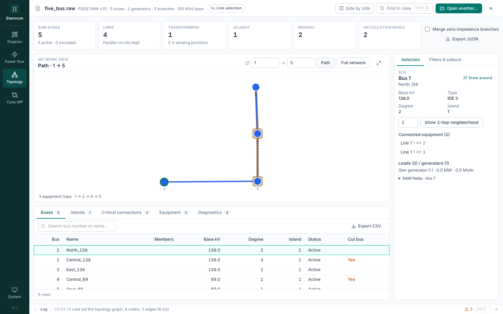
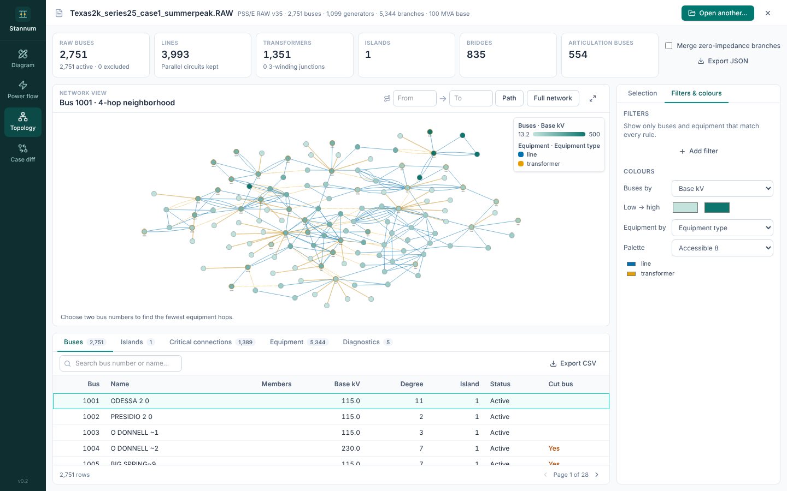
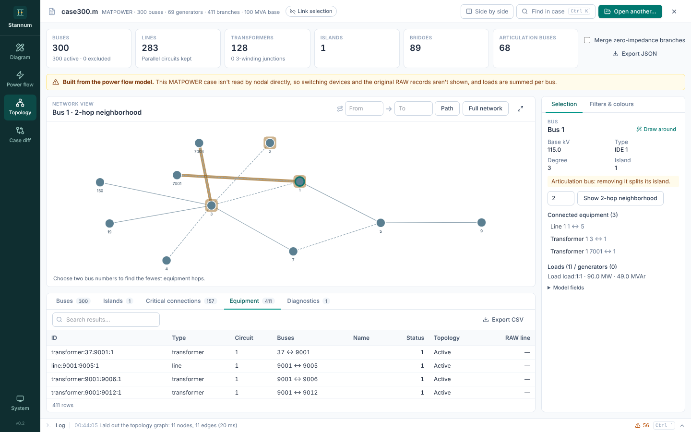

Topology shows the network as a graph: buses and the equipment between them.
At the top are counts of buses, lines, transformers, islands, bridges and
articulation buses.

## The graph

The Cytoscape graph starts from a bus's two-hop neighbourhood. From there:

- Select a bus and use **Show N-hop neighborhood** in the inspector to widen
  or narrow the view (1 to 6 hops).
- Pick an island in the **Islands** table to show all of it, or show the
  **Full network** (up to 500 nodes).
- Click a node or edge to select it and see it in the inspector.
- **Fit view** brings the drawing back into frame.

Three-winding transformers appear with a star point in the middle, so each
winding is its own edge.

## Paths

**Path** finds the fewest equipment hops between two buses and highlights the
route on the graph. Each piece of equipment crossed counts as one hop, so a
three-winding transformer is one hop between any two of its windings.

## Tables

| Tab | Shows |
| --- | --- |
| **Buses** | Every bus with its degree (connections) and island |
| **Islands** | Each island's size and buses, largest first |
| **Critical connections** | Bridges (equipment whose loss splits an island) and articulation buses (buses whose loss splits one) |
| **Equipment** | Every line, transformer and switching device |
| **Diagnostics** | Parser messages and notes on where the data came from |

All tables export to CSV, and **Export JSON** saves the parsed case, the
analysis and the current path.

## Filters and colours

The **Filters & colours** tab beside the inspector narrows the graph and
tables with the same field rules as Power flow, on buses or equipment, and
colours nodes by a field (for example base kV or area) with a palette.

## Options

**Merge zero-impedance branches** treats buses joined by zero-impedance lines
(below the case's zero-impedance threshold, 0.0001 p.u. by default) as one node, as PSS/E does.

## Any case

Topology reads revision 35 RAW files itself. For MATPOWER files and other RAW
revisions it builds the graph from the power flow model; the diagnostics say
so, and switching devices and original records aren't shown then.

See [Topology analysis](/StannumRevival/manual/topology/) for the algorithms.
