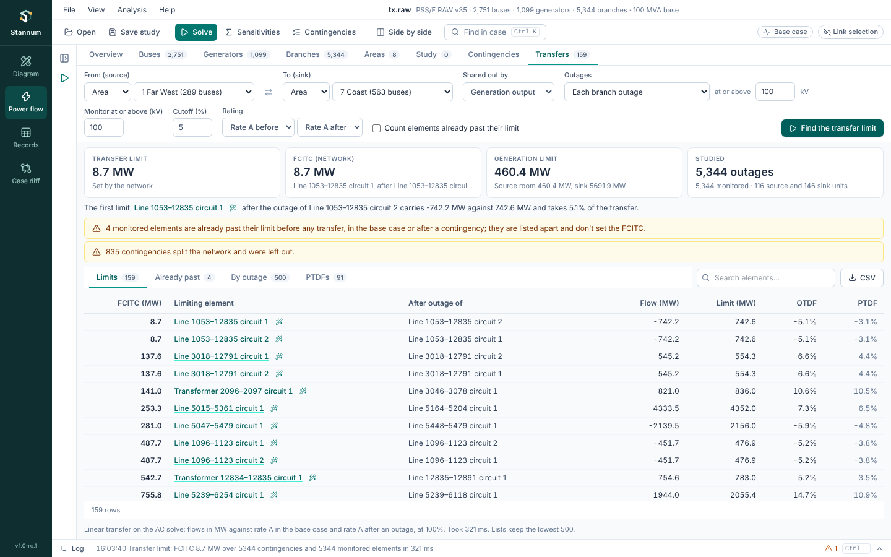

The **Transfers** tab in Power flow answers "how much more can we move from
here to there?". It moves power from a source to a sink on top of the
current AC solution (with the study's edits), and finds the first transfer
at which a monitored branch reaches its rating. It checks the base case and
each outage. The method is in the
[Transfer limits](/StannumRevival/manual/transfer-limits/) manual page.

## Running

Solve the case with the AC model first. Then choose:

- **From (source)** and **To (sink)**: an area, zone or owner from the
  list, which shows each one's bus count, or **Buses** to type bus numbers.
  The tab starts with the first and last areas of the case.
- **Shared out by**: how the MW are shared among each side's units.
  **Generation output** (the default) moves online generators in proportion
  to their output. **Generation reserve** uses their room to Pmax on the
  source and to Pmin on the sink. **Load** lowers the source's loads and
  raises the sink's.
- **Outages**: **Base case only**, **Each branch outage**, or each branch
  and generator outage, with an optional voltage floor. Outages that split
  the network are left out and counted in a note.
- **Monitor at or above (kV)**: rated branches with a terminal at or above
  this voltage are monitored.
- **Cutoff (%)**: an element that carries less than this share of the
  transfer never limits it (5% by default).
- **Rating**: the rating in the base case and after an outage.
- **Lists file (optional)**: a [lists file](/StannumRevival/reference/lists-file/#transfers)
  whose `transfer` record sets the source, sink, scaling, cutoff and
  ratings (type its name, or leave it blank for the file's only one), and
  whose contingencies and monitors, when it has them, replace the outages
  and monitored branches above. A note under the results says which
  transfer ran and what the file left out. The **×** stops using it.
- **Count elements already past their limit**: by default an element over
  its limit before any transfer is listed apart under **Already past** and
  doesn't set the answer. Tick this to let it set a negative FCITC, as
  PSS/E reports it.
- **Already past from**: the loading, in percent of the limit, at which an
  element counts as already past it (100 by default). An element at 99.9%
  after an outage sets an FCITC of a few MW, which is right but rarely
  useful; lower this to 95 to list such elements apart. When the first
  limit is at 95% or more before any transfer, the sentence under the
  results says so.

Then press **Find the transfer limit**. A Texas 2k study with every branch
outage takes well under a second. **Cancel** stops a long run and keeps the
outages studied so far.

## Results

- **Transfer limit**: the smaller of the network limit and the generation
  limit, and which one sets it.
- **FCITC (network)**: the transfer at which the first monitored element
  reaches its limit, with the element and the outage.
- **Generation limit**: how far the source can rise and the sink can fall
  before its units reach their limits.
- **Studied**: outages, monitored elements and units on each side.

The tables below them:

- **Limits**: each limiting element at its lowest FCITC, with its flow,
  limit, OTDF (its share of the transfer after the outage) and PTDF (its
  share in the base case). Click an element to show it; the draw button
  next to it draws a one-line around it.
- **Already past**: elements over their limit before any transfer.
- **By outage**: each outage's lowest FCITC and the element that sets it.
- **PTDFs**: every monitored element's base case share of the transfer, at
  or above the cutoff.

**CSV** saves the limits. Each list keeps its lowest 500 rows; run files,
[Python](/StannumRevival/guide/python/#transfer-limits) and the
[MCP server](/StannumRevival/guide/ai-assistants/) return as many as you
ask for.

A new case or a change to the study clears the results. **Transfer limits**
is also in the Analysis menu and the command palette (Ctrl+K).
