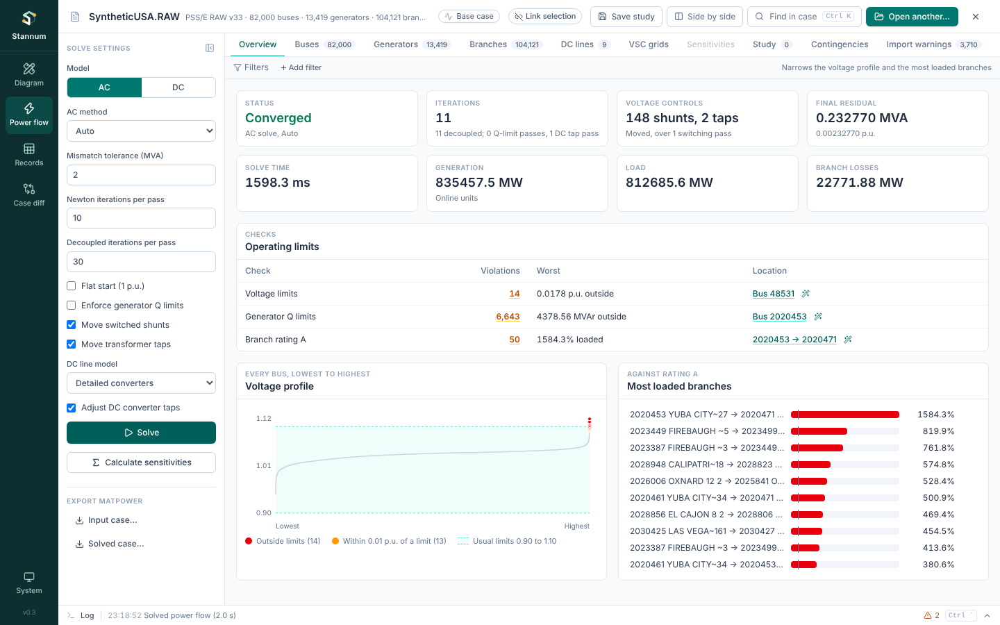

Every AC pass solves the same equations, described in [AC Newton power
flow](/StannumRevival/manual/ac-power-flow/). The **AC method** in the solve
settings picks how a pass gets there. All methods stop at the same mismatch
tolerance, checked on the full AC equations, so they reach the same answer
to that tolerance; they differ in how long it takes and in how hard a case
they can solve.

| Method | Setting | Each iteration | Good for |
| --- | --- | --- | --- |
| **Auto** (default) | `"auto"` | Decoupled, then Newton if needed | Every case |
| **Full Newton** | `"newton"` | Builds and factors the whole Jacobian | Hard, heavily loaded or badly started cases |
| **Fixed-slope decoupled (FDNS)** | `"fixed_slope"` | Two solves with matrices factored once per pass | Large cases |
| **Fast decoupled (XB)** | `"fast_decoupled_xb"` | Two solves with constant network matrices | Large, ordinary transmission cases |
| **Fast decoupled (BX)** | `"fast_decoupled_bx"` | As XB, resistance dropped from the other matrix | High R/X networks |

The passes around each solve (reactive limits, shunts, taps, HVDC taps and
limits) are the same for every method.



## Decoupled iterations

Near a solution, active power depends mostly on angles and reactive power on
voltage magnitudes. The decoupled methods use this: instead of the full
Newton system they solve two smaller ones in turn, each iteration being

$$
B'\,\Delta\theta = -\frac{\Delta P}{\lvert V\rvert}
\quad\text{then, with the new angles,}\quad
B''\,\Delta\lvert V\rvert = -\frac{\Delta Q}{\lvert V\rvert}.
$$

$B'$ and $B''$ are factored once at the start of a pass and reused by every
iteration, so an iteration costs two triangular solves and two mismatch
evaluations, far less than a Newton step on a large case. They converge
linearly rather than quadratically, so they take more iterations, and the
**Decoupled iterations per pass** limit (30 by default) is separate from the
Newton one. Magnitude steps are capped like Newton's (no more than half the
present magnitude).

### Fast decoupled, XB and BX

The fast decoupled load flow (B. Stott and O. Alsac, *IEEE Trans. PAS-93*,
1974) builds $B'$ and $B''$ from the network alone, as $-\mathrm{Im}$ of a
simplified admittance matrix:

- $B'$ leaves out shunts, line charging, off-nominal tap ratios and phase
  shifts.
- $B''$ keeps charging, bus shunts and tap ratios but leaves out phase
  shifts.

R. A. M. van Amerongen (*IEEE Trans. Power Systems* 4(2), 1989) showed which
of the two should drop series resistance:

- **XB** drops it from $B'$ ($b = 1/x$), Stott and Alsac's original choice.
- **BX** drops it from $B''$ instead, which converges better on networks
  with high R/X ratios.

These are the same simplifications as MATPOWER's `makeB`. A branch with no
reactance keeps its impedance magnitude in the matrix that drops resistance.

### Fixed-slope decoupled Newton (FDNS)

The fixed-slope method uses the Jacobian's own diagonal blocks,
$\partial P/\partial\theta$ and $\partial Q/\partial\lvert V\rvert$, taken at
the voltages that start the pass (the "fixed slope") and reused, with the
mismatch unscaled. Unlike the fast decoupled matrices these include the real
voltages and angles, phase shifts, the reactive-power sharing rows of
[remote regulation](/StannumRevival/manual/remote-regulation/) and the
voltage derivatives of detailed [HVDC](/StannumRevival/manual/hvdc/overview/)
converters.

The magnitude block is taken with series resistance left out, as BX does for
$B''$. With the exact block the two halves can push each other apart on
lines whose resistance is close to their reactance: the IEEE 300-bus case
(buses 9043–9044) and the 70,000–82,000-bus synthetic cases all diverge that
way, and converge with resistance left out of one block.

When an iteration does not reduce the mismatch, the blocks are taken again at
the present voltages (at most three times per pass).

## Auto

Auto starts each pass with fixed-slope decoupled iterations and watches how
fast the mismatch falls:

- If they converge, the pass is done.
- If they slow down, so that at the rate of the last two iterations they
  would need more than 20 more to reach the tolerance, or the mismatch rises
  twice, or grows tenfold in one iteration, or they hit the decoupled
  iteration limit, Newton finishes the pass from the best point they reached.
- If they fail outright (a singular matrix, an unusable voltage), Newton
  solves the pass from where it started.

Newton converges quadratically, so it finishes a slowed-down pass in a few
steps. Later passes start close to the solution, where decoupled iterations
almost always converge. The Overview's **Iterations** shows how many
iterations were decoupled and how many Newton, and the log says when a pass
switched to Newton.

## Timings

Release build, one solve from the voltages in the file, with the detailed
HVDC model and switched shunts and taps on (RAW cases). Times include the
control passes. Auto's iterations are decoupled unless noted.

| Case | Tolerance | Q limits | Full Newton | FDNS | Fast decoupled XB | Fast decoupled BX | Auto |
| --- | --- | --- | --- | --- | --- | --- | --- |
| SyntheticUSA (82,000 buses) | 2 MVA | off | 4.0 s (8) | 1.6 s (11) | 1.6 s (9) | 1.4 s (10) | 1.5 s (11) |
| SyntheticUSA (82,000 buses) | 0.01 MVA | off | 4.4 s (9) | 2.1 s (15) | 1.8 s (13) | 2.0 s (17) | 1.9 s (15) |
| SyntheticUSA (82,000 buses) | 2 MVA | on | 12.5 s (26) | 6.9 s (41) | 6.2 s (37) | 6.3 s (39) | 7.0 s (41) |
| SyntheticUSA (82,000 buses) | 0.01 MVA | on | 15.1 s (32) | 9.0 s (59) | 8.2 s (55) | 8.4 s (57) | 8.8 s (59) |
| East-West US (80,000) | 2 MVA | off | 2.6 s (6) | 1.4 s (10) | 0.9 s (7) | 0.9 s (9) | 1.3 s (10) |
| East-West US (80,000) | 0.01 MVA | off | 3.4 s (8) | 1.4 s (16) | 1.0 s (12) | 1.0 s (15) | 1.4 s (16) |
| East-West US (80,000) | 2 MVA | on | 10.4 s (23) | 4.2 s (32) | 3.8 s (31) | 3.9 s (30) | 3.9 s (32) |
| East-West US (80,000) | 0.01 MVA | on | 10.5 s (25) | 5.5 s (44) | 5.1 s (42) | 5.4 s (43) | 6.5 s (44) |
| ACTIVSg70k (70,000) | 2 MVA | off | 1.9 s (4) | 0.5 s (6) | 0.5 s (4) | 0.5 s (6) | 0.5 s (6) |
| ACTIVSg70k (70,000) | 0.01 MVA | off | 2.1 s (5) | 0.5 s (9) | 0.5 s (9) | 0.5 s (10) | 0.5 s (9) |
| ACTIVSg70k (70,000) | 2 MVA | on | 4.0 s (9) | 1.8 s (15) | 2.0 s (13) | 1.8 s (15) | 1.8 s (15) |
| ACTIVSg70k (70,000) | 0.01 MVA | on | 5.1 s (12) | 4.8 s (28) | 3.9 s (28) | 4.9 s (34) | 4.6 s (28) |

Iterations in brackets. One run each on a shared 4-core cloud machine, so treat
differences under about 10% as noise.

With reactive limits on, the methods can end with a few generators near
their limits on different sides (PV in one solve, at a limit in another).
That is a different, equally valid solution of the limit problem, not an
inaccuracy: every result meets the tolerance and the limits. At 2 MVA the
solutions agree within 0.0002 p.u.; at 0.01 MVA, where the solve stops
loosely while limits switch, 50–90 of 80,000 buses ended up with a different
type and voltages differed by up to 0.011 p.u. near them. Newton itself
lands differently from different starting points in the same way.

From a flat start none of these large cases converge, with any method.

## Choosing

Auto is the default and the right choice almost always. Pick **Full
Newton** for a case that is hard to solve, since a decoupled stage that fails
costs a little time before Newton takes over. Pick one of the decoupled
methods to compare with another program that uses it.

In run files and Python the setting is `method`, and the limits are
`max_iterations` (Newton) and `decoupled_iterations`:

```
solve_power_flow method=fast_decoupled_bx decoupled_iterations=50
```

```python
case.solve(method="newton")
```
