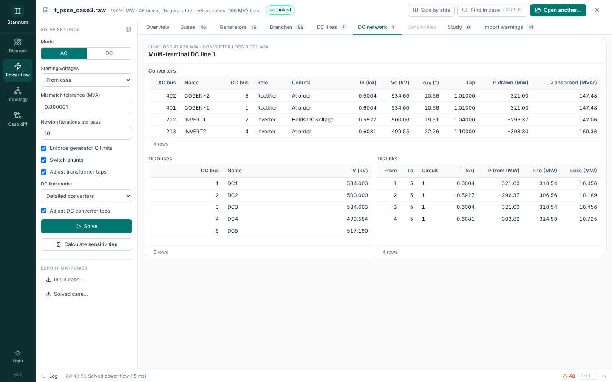

A multi-terminal DC (MTDC) system has DC buses, resistive DC links between
them, and line-commutated converters. Each converter sits between one DC bus
(`IDC`) and a second DC bus or ground (`IDC2`), on the pole given by the
sign of `CNVCOD`.

## Converters

Each converter uses the [two-terminal bridge
equations](/StannumRevival/manual/hvdc/lcc/#converter-equations):

$$
\begin{aligned}
V_d &= V_{do}\cos\alpha - N_B\left(\tfrac{3}{\pi}X_c + 2R_c\right) I_d && \text{rectifier} \\
V_d &= V_{do}\cos\gamma - N_B\left(\tfrac{3}{\pi}X_c - 2R_c\right) I_d && \text{inverter}
\end{aligned}
$$

- The converter at `VCONV` (and `VCONVN`, the negative pole's voltage
  converter) holds the DC voltage across it at its `SETVL` kV.
- Every other converter holds its order: `SETVL` MW of DC power, or `SETVL`
  amps in current control. Orders are positive at a rectifier and negative at
  an inverter.
- Below `VCMOD`, power orders become current orders at `SETVL` over the
  voltage converter's `SETVL`.
- A converter that would need an angle below its minimum runs at that minimum
  instead and falls short of its order.

## DC network solve

The DC network is solved by Newton's method on the DC bus voltages. With the
link conductance matrix $G_{DC}$ and converter currents $I_c$ injected at
the DC buses,

$$
G_{DC}\,V_{DC} = I_c(V_{DC}),
$$

where scheduled converters' currents depend on the DC voltage (a power order
gives $I = P/V_d$) and the voltage converters' DC voltages are fixed, so the
voltage converters take the balance and the link losses. The DC Newton runs
to $10^{-10}$ with at most 50 iterations.

The DC solution is recomputed from the converter buses' AC voltages at every
AC Newton step, and its derivatives enter the AC Jacobian by central
differences.

## Tap adjustment

With **Adjust DC converter taps**, each converter's tap steps to keep its
angle within `ANGMN`…`ANGMX`. When one tap step is wider than that range,
the angle stays at or above `ANGMN`.

## Reporting

The **DC network** tab reports every DC bus voltage, link current, flow and
loss, and each converter's mode, current, DC voltage, angle, tap and AC-side
P and Q.

The case's DC line rows (one per scheduled converter, linked to the voltage
converter) also receive results: each converter's end carries its own P and Q,
and the voltage converter's end carries a share of the voltage converters' Q
and of the system's losses, in proportion to each converter's DC power, so the
rows add up to the system's losses.

A system is **blocked** when `MDC` is 0 or any of its rows is switched off.

On `t_psse_case3.raw`, DC bus 5 settles at 517.19 kV and the system's links
lose 41.8 MW.

## Not modelled

- `DCPF` and `MARG` order sharing.
- `RGRND` (used only for fault analysis in PSS/E).
- DC link inductance (irrelevant in steady state).

Import warns about margins and ground resistances.
