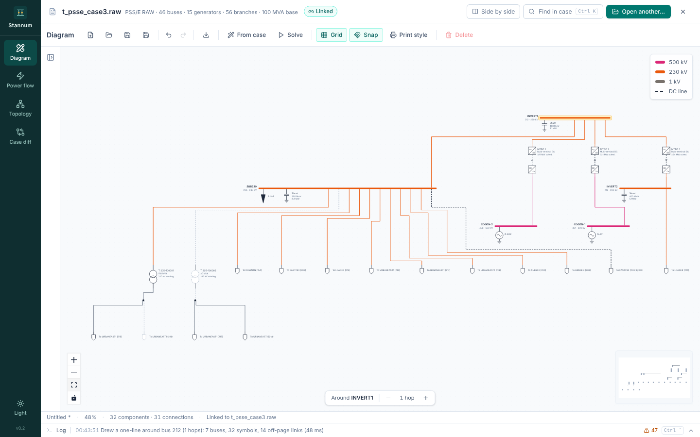

Stannum imports all three PSS/E DC line kinds and solves each with a detailed
converter model by default. The simplified MATPOWER model is still available,
and is always used for DC (linear) solves.

| Kind | RAW section | Detailed model |
| --- | --- | --- |
| Two-terminal LCC | Two-terminal DC line data | [Two-terminal LCC](/StannumRevival/manual/hvdc/lcc/) |
| Two-terminal VSC | Voltage source converter (VSC) DC line data | [Two-terminal VSC](/StannumRevival/manual/hvdc/vsc/) |
| Multi-terminal LCC | Multi-terminal DC line data | [Multi-terminal DC](/StannumRevival/manual/hvdc/mtdc/) |

Meshed and multi-terminal VSC grids aren't part of RAW files. They come from a
[Stannum DC grid file](/StannumRevival/reference/dc-grid-file/) attached to
the case and are solved as described in [Meshed VSC
grids](/StannumRevival/manual/hvdc/vsc-grids/).

Choose the model with **DC line model** in the solve settings: **Detailed
converters** (the default for RAW files) or the simplified model.
**Adjust DC converter taps** lets converter transformer taps step to hold
scheduled DC voltages and keep firing angles in range.

## Simplified model

MATPOWER represents an active DC line as a pair of generators, one at each
terminal (its `toggle_dcline` power-flow representation):

- The sending end withdraws the scheduled power $P_f$; the receiving end
  injects $P_t = P_f - (L_0 + L_1 P_f)$, with linear losses (zero for RAW
  imports, which are lossless).
- Each end holds its terminal voltage within its reactive range, like a PV
  generator.

Stannum refines two details of MATPOWER's RAW import:

- **LCC converters absorb reactive power.** MATPOWER writes the estimated
  reactive limits of line-commutated converters as positive (supplied) Mvar.
  Stannum stores them as $[-Q_{\max}, -Q_{\min}]$.
- **Fixed-Q ends.** An end whose reactive range has zero width (a VSC in power
  factor control) injects that fixed Mvar rather than holding its bus voltage.

VSC lines and multi-terminal systems, which MATPOWER skips, are added as rows
too: a VSC line as one row scheduled at its power converter's order, and a
multi-terminal system as one row per scheduled converter linked to the
voltage-controlling converter, which takes the balance.

## Detailed models in the AC solve

The detailed models replace the generator pair with **voltage-dependent
injections** at the converter buses:

1. At every Newton iteration, each DC line or system computes its operating
   point from the present AC terminal voltage magnitudes: currents, DC
   voltages, firing angles and the P and Q drawn at each converter bus.
2. Those injections enter the AC mismatch, and their derivatives with respect
   to the terminal voltage magnitudes enter the Jacobian (analytically for
   two-terminal LCC, by central differences for multi-terminal systems).
3. Between Newton solves, [passes](/StannumRevival/manual/ac-power-flow/#passes)
   step converter taps and enforce VSC limits.

This is a **sequential** method inside each Newton step rather than one
unified AC/DC Newton system. It keeps each DC model separate and testable; a
unified formulation may follow later.

## Results

The **DC lines** and **DC network** tabs show each line's control mode,
current, DC voltages, angles, taps, losses, and both ends' P and Q. The
case's DC line rows also receive the AC-side P and Q and terminal voltages, so
an exported MATPOWER case carries them.

