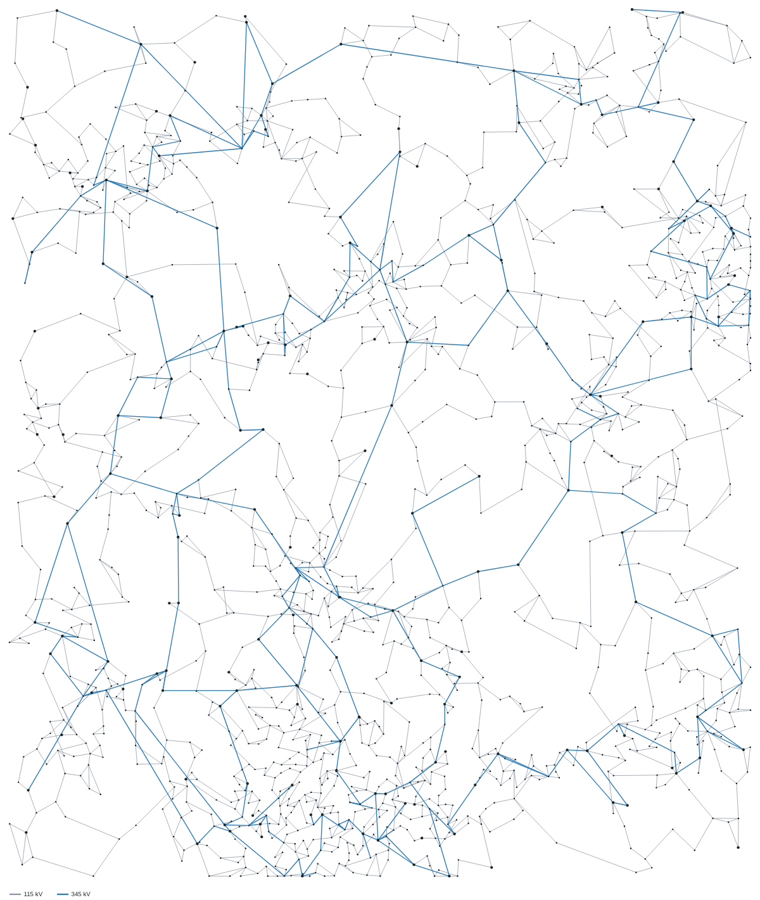

Stannum can build synthetic power system cases: fictitious grids that are
free to share and test with, but that look like real ones. They come from
the `stannum-synth` crate, which follows

> A. B. Birchfield, T. Xu, K. M. Gegner, K. S. Shetye and T. J. Overbye,
> "Grid Structural Characteristics as Validation Criteria for Synthetic
> Networks," *IEEE Transactions on Power Systems*, vol. 32, no. 4,
> pp. 3258-3265, July 2017.

The same seed always builds the same case, on any machine, so a test can
generate the large case it needs instead of downloading one.

## Building a case

```powershell
pwsh scripts/new-synthetic-case.ps1 -Buses 2000 -Seed 1 -Out cases/
```

This writes five files named after the case:

| File | What it holds |
| --- | --- |
| `.stn` | The case as a [Stannum case](/StannumRevival/reference/case-file/), solved: voltages and dispatch are the ac solution. |
| `.coords.csv` | Latitude and longitude of every bus (its substation's). |
| `.report.md` | Sizes, the structural statistics below, and the ac solve. |
| `.report.json` | The same report for scripts and tests. |
| `.svg` | A map of substations and lines, coloured by voltage. |

Each generator holds the high-voltage bus of its plant, through its step-up
transformer, as plants do. That's why the case is written as a Stannum case:
MATPOWER has no column for the bus a generator regulates, so in a `.m` file
every unit would hold its own terminals, and the case would no longer solve
with reactive limits on. **Export case as MATPOWER** writes a `.m` copy if you need
one.

`-Config settings.json` reads every setting (see `stannum_synth::Config`):
footprint, voltage levels, load per substation, fuel mix, line quotas and
penalties.

## How a case is built

The steps follow the paper's flowchart (its Fig. 4).

1. **Load substations.** Population points (a synthetic census of Zipf-sized
   cities and rural points) are clustered into substations, closest first,
   with a cap on the population any one substation serves (Table I). Areas
   are compact regions of about 200 substations; each has its own
   consumption per person (Table IV), scaled to the system's peak load.
2. **Generation.** Plants are drawn by fuel with log-normal sizes. A few
   load substations (5.6%) take nearby coal and gas plants until they reach
   a capacity drawn from the generation-to-load ratio of Fig. 2. The other
   plants are clustered into generation-only substations (5.5%), never
   putting hydro, nuclear or renewables with another fuel (Table II).
3. **Voltage levels.** Every substation has a bus at the lowest level.
   Substations whose load or generation is more than a few lines at that
   level could carry get the next level up, and the rest of each level's
   share is drawn at random, weighted to large load and generation.
4. **Lines.** At each level, candidates are pairs of substations within
   three steps on that level's Delaunay triangulation (about 23 per
   substation). Each round, every candidate is scored with the penalties of
   Table V and the best few are added, until the level has 1.22 lines per
   substation. Candidates more than five times the level's median
   triangulation edge are left out (unless they are on the minimum spanning
   tree), since long edges on the triangulation's outer hull would carry
   bulk power across the whole footprint:

   | Criterion | Score |
   | --- | --- |
   | Length | +2 per mile |
   | Estimated dc flow | -0.5 per MW |
   | Category ahead of its quota | +200 |
   | Joins a split level, or reaches a radial substation | -300 |
   | Leaves a cut substation behind (no shared biconnected block) | -1000 |
   | Each line it would cross | +500 |

   The flow estimate comes from a dc power flow on substations, re-solved
   as lines are added. Until real lines connect everything, temporary
   impedances along the minimum spanning tree keep it solvable; they grow
   each round and are dropped once the network is connected (Section III-D).
5. **Conductors.** Lines get typical ACSR conductors, bundles at 345 kV and
   above, and a tower spacing drawn per line; $R$, $X$, $B$ and the rating
   follow the paper's eqs. 2-5. Conductors, parallel circuits and
   transformers are sized from dc flows.
6. **AC solve.** Generators hold their substation's high-side bus with
   reactive limits enforced, sharing its reactive power by the size of
   their reactive range so they reach their limits together. If the case doesn't solve from a flat start,
   load is brought up in steps, adding capacitor banks where voltages sag
   below 0.97 pu before each next step. At full load, capacitors, reactors
   and upgrades bring voltages into 0.97-1.05 pu and branches under 85%
   loading.

## Validation

The report measures the paper's criteria for each voltage level. The same
measurement works on any case whose substations have coordinates.

| Statistic | Target (Table VI) |
| --- | --- |
| Lines per substation, m/n | 1.22 |
| On the minimum spanning tree | 50% |
| On the Delaunay triangulation | 70% |
| Second Delaunay neighbours | 25% |
| Third Delaunay neighbours | 5% |
| Lines that cross another line of the level | under 20% |
| Connected at every level, and after losing any one substation | yes |

A 2,000-bus case (seed 1) builds in about 5 seconds:

| Statistic | 115 kV | 345 kV |
| --- | --- | --- |
| n | 1,482 | 222 |
| m/n | 1.32 | 1.22 |
| Minimum spanning tree | 49.8% | 49.1% |
| Delaunay triangulation | 70.9% | 70.1% |
| Delaunay 2 neighbour | 24.4% | 25.5% |
| Delaunay 3 neighbour | 4.7% | 4.4% |
| Line intersections | 1.7% | 0.0% |

It solves in 11 Newton iterations with every load bus between 0.97 and
1.05 pu and no branch over 85%. No substation's loss splits the network.



## Where this differs from the paper

- **Census and plant data are synthesized.** The paper places load from
  census postal codes and plants from EIA-860. Synthesizing both from a seed
  means any size of case can be built anywhere with nothing to download. The
  geography is a rectangle, not a real territory.
- **Cluster distance** is between population-weighted centres, and only
  Delaunay neighbours are compared, instead of the average distance between
  all members (eq. 1). The nearest cluster is always a Delaunay neighbour,
  and this keeps 100,000 points to seconds.
- **More lines per substation at the lowest level** (about 1.32 rather than
  1.22, 1.38 at 80,000 buses). After the main rounds, any level still split, and any substation
  whose loss would split the network, is fixed with the shortest
  candidates. The report counts these lines.
- **More shunt compensation.** The paper's 2,000-bus case needed 36
  capacitor banks; generated cases get a few hundred, placed automatically.
- **Dispatch by fuel and area.** Wind, solar and hydro run at typical peak
  output, nuclear and coal near full, and gas fills the rest; gas and coal
  are then moved between areas so each covers its own load where it can.
- **Large cases.** Above 10,000 buses there are three levels (115, 230 and
  500 kV) and less load per substation, so an 80,000-bus case carries about
  600 GW, near the Eastern Interconnection's peak. Where a load step won't
  solve, shunts are added for the reactive power generators would need
  beyond their limits.
- **80,000 buses is nearly as clean as 2,000.** Seed 1 builds in about
  half an hour and solves at full load, with every structural statistic in
  range. 2 buses sit outside 0.97-1.05 pu, 8 branches run over their limit,
  and 2 substations are still cut.
- **Underground cables** and the paper's further complexities (transient
  stability data, costs) are not generated yet.
