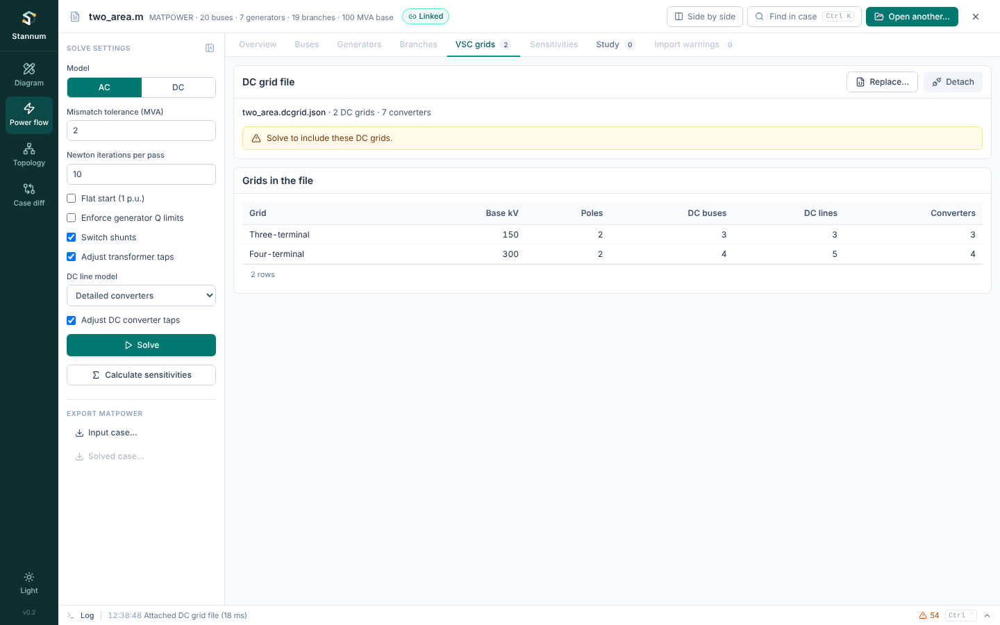

A Stannum DC grid file (`*.dcgrid.json`) describes one or more VSC DC grids.
It sits beside an AC case and names the case's AC buses by number, so the
same file works for every variant of a case. Attach it in **Power flow →
VSC grids**. The model behind each field is in [Meshed VSC
grids](/StannumRevival/manual/hvdc/vsc-grids/).



## Example

```json
{
  "format": "stannum-dc-grids",
  "version": 1,
  "description": "Optional note",
  "grids": [
    {
      "name": "North Sea",
      "base_kv": 320,
      "poles": 2,
      "buses": [{ "number": 1, "name": "Hub" }, { "number": 2, "name": "Wind" }],
      "lines": [{ "from": 1, "to": 2, "name": "Cable", "r_ohm": 4.2 }],
      "converters": [
        {
          "name": "Shore",
          "ac_bus": 5,
          "dc_bus": 1,
          "dc_control": { "mode": "slack", "v_dc_pu": 1.0 },
          "ac_control": { "mode": "reactive", "q_mvar": 0 },
          "transformer": { "r_pu": 0.0015, "x_pu": 0.1121 },
          "filter_b_pu": 0.0887,
          "reactor": { "r_pu": 0.0001, "x_pu": 0.16428 },
          "losses": { "a_mw": 1.103, "b_kv": 0.887, "c_rectifier_ohm": 4.371, "c_inverter_ohm": 2.885 },
          "limits": { "i_max_pu": 1.1, "uc_max_pu": 1.2, "uc_min_pu": 0.85 }
        },
        {
          "name": "Wind",
          "ac_bus": 9,
          "dc_bus": 2,
          "dc_control": { "mode": "power", "p_mw": -400 },
          "ac_control": { "mode": "voltage", "v_pu": 1.0 },
          "reactor": { "r_pu": 0.0001, "x_pu": 0.16 }
        }
      ]
    }
  ]
}
```

Unknown fields are refused, so a misspelt field is an error rather than a
silent default. Optional fields are marked with their default.

## File

| Field | Meaning |
| --- | --- |
| `format` | Always `"stannum-dc-grids"`. |
| `version` | File version, `1`. |
| `description` | Free text. Optional. |
| `grids` | One or more DC grids. |

## Grid

| Field | Meaning |
| --- | --- |
| `name` | Unique name. |
| `base_kv` | Pole-to-ground DC voltage base in kV. DC voltages in the file are per unit of it. |
| `poles` | `1` for an asymmetric monopole, `2` for a symmetric monopole or bipole. Default `2`. |
| `buses` | DC buses: `number` (positive, unique in the grid) and `name` (optional). |
| `lines` | DC lines. Optional. |
| `converters` | Converter stations. |

## Line

| Field | Meaning |
| --- | --- |
| `from`, `to` | DC bus numbers. |
| `r_ohm` | Resistance of one pole conductor in ohms; positive. |
| `name` | Optional. |
| `in_service` | Default `true`. |

## Converter

| Field | Meaning |
| --- | --- |
| `name` | Optional. |
| `ac_bus` | AC system bus number in the case. |
| `dc_bus` | DC bus number in its grid. |
| `in_service` | Default `true`. |
| `dc_control` | One of the DC controls below. |
| `ac_control` | One of the AC controls below. |
| `transformer` | `r_pu`, `x_pu`: transformer impedance. Default none. |
| `filter_b_pu` | Filter susceptance. Default none. |
| `reactor` | `r_pu`, `x_pu`: phase reactor impedance. Default none. The transformer and reactor together must not be zero. |
| `losses` | `a_mw`, `b_kv`, `c_rectifier_ohm`, `c_inverter_ohm` of $P_\text{loss} = a + b I_c + c I_c^2$, $I_c$ in kA. Each defaults to 0. |
| `limits` | `i_max_pu` (converter current), `uc_max_pu` and `uc_min_pu` (converter voltage). Each defaults to 0, meaning no limit. |

Impedances, susceptance, current and converter voltage are per unit on the
case's MVA base and the AC bus's base kV. The rectifier coefficient applies
while the converter takes power from the AC grid, the inverter coefficient
while it delivers power to it.

### DC control

| `mode` | Fields | Holds |
| --- | --- | --- |
| `"power"` | `p_mw` | Active power into the AC grid at its system bus (negative: taken from it). |
| `"slack"` | `v_dc_pu` | Its DC bus voltage. One slack converter per DC bus. |
| `"droop"` | `p_mw`, `v_dc_pu`, `mw_per_kv` | DC-side power out of the grid of `p_mw + mw_per_kv × (U − v_dc_pu × base_kv)`, U in kV. |

Every part of a grid with a converter needs at least one slack or droop
converter.

### AC control

| `mode` | Fields | Holds |
| --- | --- | --- |
| `"reactive"` | `q_mvar` | Reactive power into the AC grid. |
| `"voltage"` | `v_pu` | AC voltage magnitude at its bus, which must have no generators and not be the reference bus. One converter per bus. |

## Checks

When attached, the file is checked against the case: every `ac_bus` must
exist and not be isolated, and the grids must satisfy the rules above. A
file that fails stays unattached and the message names the grid, converter
or line. A study edit that removes a converter's AC bus makes the next
solve fail with the same kind of message.
